# What the main paper figures show

## Short version

Across the 48 Evoformer layers, final-structure distance information becomes
progressively easier to read from the pair representation. The progression is
not smooth: the largest gains recur around layers 8, 13, 15--16, 35, and
42--44, with a real regression around layers 26--30 and a small reversal in the
last few layers. By the end, a shared nonlinear readout (XGBoost) on unseen
proteins nearly matches the protein-specific linear readout on held-out pairs,
while the shared linear readout remains weaker. Accurate pairwise distances do
not automatically form a coherent three-dimensional geometry: this depends
strongly on the readout.

Sequence separation is especially useful for local pairs. Amino-acid identity,
by contrast, changes which decoder works best for particular residue pairs but
adds almost nothing to the whole-protein average. Protein category,
architecture, and length mainly shift when refinement happens; their
differences become small by the final layers.

## What was done

At each layer, one observation was made for every unordered residue pair. Its
input was the concatenation of the two directional 128-channel pair entries,
`[Z_ij | Z_ji]`, giving 256 features. The target was the C-alpha distance in
OpenFold's final predicted PDB. These results therefore measure how accessible
OpenFold's own final geometry is from an intermediate representation. They do
not measure agreement with an experimental structure, establish causality, or
show that OpenFold itself uses the fitted decoder.

The shared models were fitted on 441 development proteins and evaluated on the
same locked set of 111 test proteins. The main model-comparison figures use
mean per-protein metrics; subgroup figures use pooled pair metrics. The five
variants were:

| Variant | What was fitted at each layer | What its test result means |
|---|---|---|
| Shared linear | One ordinary least-squares decoder shared across proteins | One linear rule transfers to unseen proteins |
| Per-protein linear | One ordinary least-squares decoder per protein, fitted on 80% of that protein's pairs | A protein-specific rule transfers to held-out pairs in the same protein |
| XGBoost | One shared nonlinear tree ensemble; the final fixed configuration used at most 5,000 fitting pairs per protein | A nonlinear rule transfers to unseen proteins |
| Sequence gated | Six shared linear decoders, one for each sequence-separation bin | The transferable linear rule can depend on sequence scale |
| AA gated | 210 shared linear decoders, one for each unordered standard amino-acid pair | The transferable linear rule can depend on residue identity |

The per-protein curve is useful as a protein-specific accessibility ceiling,
but it is not a like-for-like competitor to the shared models. In Figures 1,
2, 9, and 15 it is evaluated on held-out pairs. Complete distance matrices are
required for geometry, so its rows in Figures 3--5 and 8 mix fitting and
held-out pairs.

The exact figure sources, scopes, and derived tables are recorded in the
[figure manifest](paper_figures/figure_manifest.csv).

## Figure 1: Mean per-protein R2

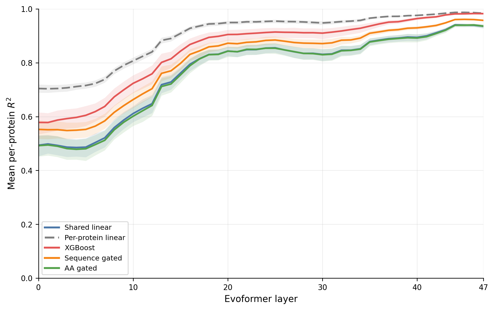

This is the main measure of how much within-protein distance variation each
readout explains. The shaded regions are protein-bootstrap 95% intervals.
Every model improves substantially, with repeated step-like gains and a shallow
middle-layer decline.

The shared linear model rises from 0.494 at layer 0 to 0.936 at layer 47. The
sequence-gated model finishes higher at 0.957, while AA gating is essentially
identical to the ungated shared linear model at 0.936. XGBoost reaches 0.982 on
unseen proteins, close to the per-protein linear result of 0.984 on held-out
pairs. Most variants peak at layers 44--46 rather than at layer 47, showing a
small late reversal.

## Figure 2: Mean per-protein MAE

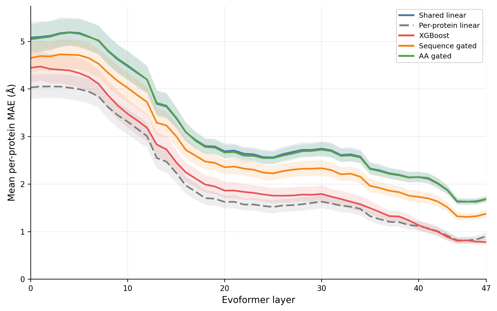

This shows the typical absolute distance error for a protein in angstroms and
largely confirms the R2 result. Shared linear improves from 5.08 to 1.68 Å,
sequence gated from 4.65 to 1.37 Å, and XGBoost from 4.44 to 0.78 Å. The
per-protein model ends at 0.90 Å on held-out pairs. AA gating again changes
little at the whole-protein level: its final 1.68 Å is nearly the shared-linear
result. XGBoost has the lowest final MAE despite the per-protein model having a
slightly higher mean R2; the metrics weight the protein-level error
distributions differently.

## Figure 3: Reconstruction TM-score

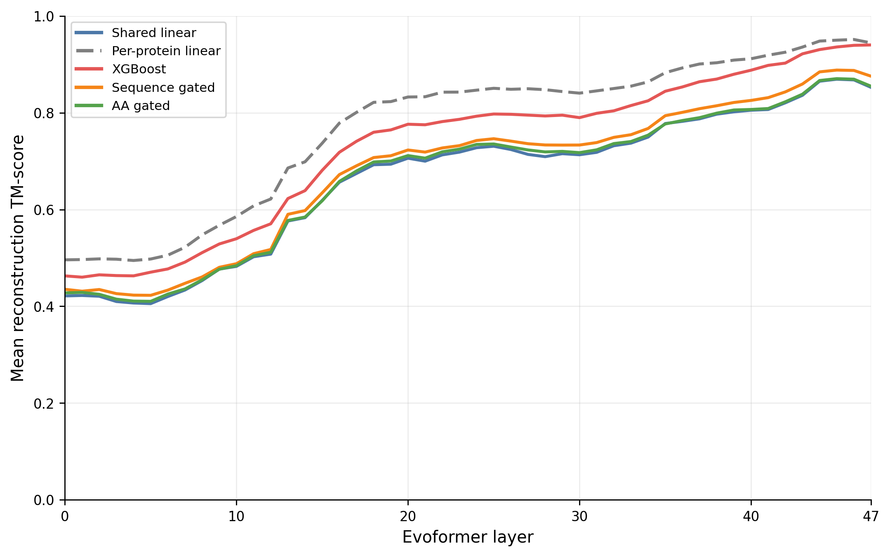

Each complete predicted distance matrix was converted to three-dimensional
coordinates with classical multidimensional scaling and aligned to OpenFold's
final predicted structure. The plot asks whether pairwise decoding is good
enough to recover the global fold, not whether the fold matches experiment.

Reconstruction quality follows regression accuracy. Final mean TM-scores are
0.852 for shared linear, 0.855 for AA gated, 0.876 for sequence gated, 0.940
for XGBoost, and 0.944 for per-protein linear. The last value includes the
per-protein model's fitting pairs. As in Figure 1, most linear variants are
best around layers 45--46 and decline slightly afterward.

## Figure 4: Top-three positive eigenvalue fraction

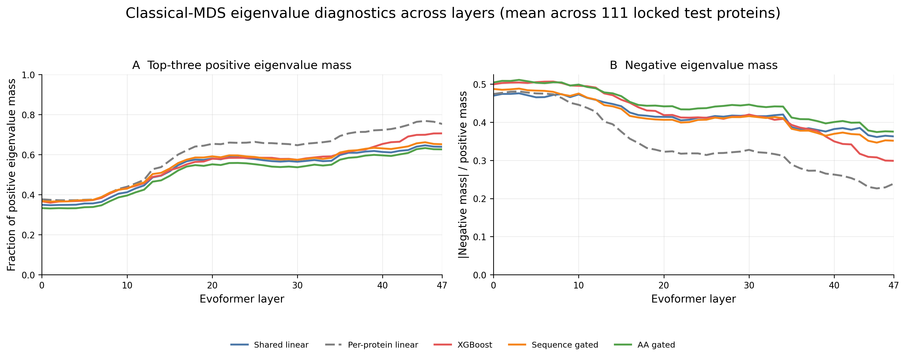

This measures how much of the positive classical-MDS spectral mass lies in the
top three dimensions. It is a low-dimensionality diagnostic, not proof that a
distance matrix is Euclidean.

The fraction rises for every model, so late-layer decoded matrices are much
more concentrated in a three-dimensional subspace. At layer 47 it ranges from
0.626 for AA gated and 0.639 for shared linear to 0.706 for XGBoost and 0.753
for per-protein linear. None reaches 1, which is consistent with the remaining
distance errors and triangle violations.

## Figures 5--6: Triangle-violation diagnostics

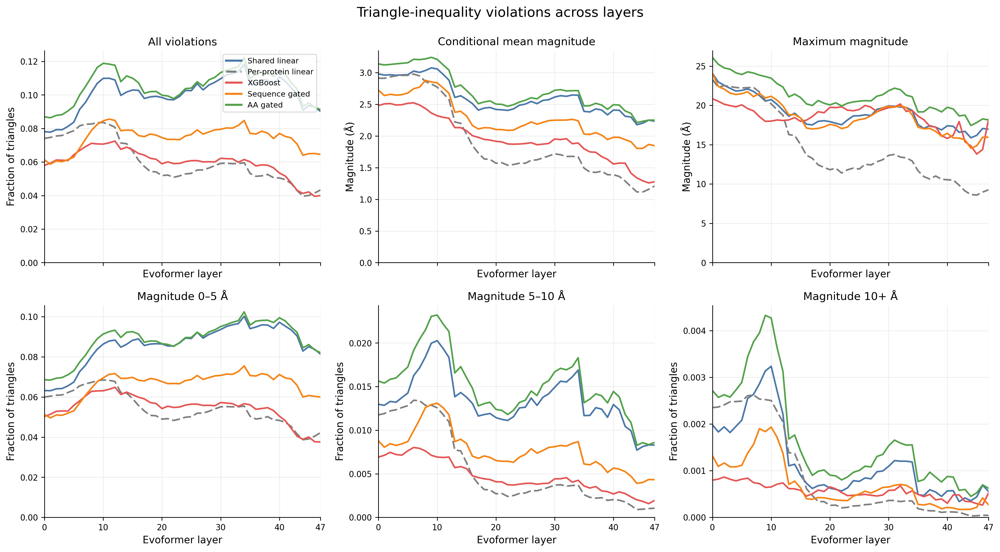

The original Figure 5 and Figure 6 specifications were combined into this
six-panel result. It reports the fraction of all residue triples that violate
the triangle inequality, the mean magnitude conditional on a violation, the
maximum magnitude, and the fractions in three severity ranges.

The key result is that violation frequency and severity behave differently.
Shared linear and AA-gated predictions become more accurate across layers, yet
their total violation fractions rise from roughly 8--9% to about 9%. This is
driven by numerous mild 0--5 Å violations. At the same time, their conditional
mean violation shrinks from about 3.0 Å to about 2.2 Å and their severe 10+ Å
violations become much rarer. Sequence gating shows the same broad pattern at
lower severity.

XGBoost and per-protein linear improve both frequency and severity, ending near
4% violating triangles and about 1.2--1.3 Å conditional magnitude. Thus better
pairwise decoding can coexist with worse metric consistency for a linear
readout; the nonlinear and protein-specific readouts recover a substantially
more coherent distance matrix.

## Figure 7: Layer-to-layer R2 gain

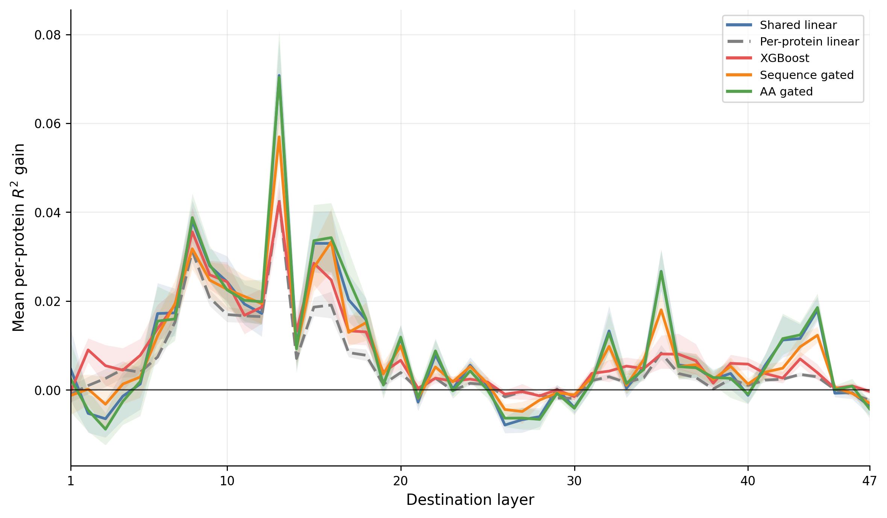

This plots the paired change in each protein's R2 from one layer to the next;
intervals above or below zero indicate a consistent change across proteins.
The largest gain for every model is the transition into layer 13. Other common
bursts occur at layers 8, 15--16, 35, and 42--44. All five models lose
decodability around layers 26--30 before recovering, and most have a small
drop at layer 47. The agreement in transition locations across very different
readouts suggests that these are changes in the representation rather than an
artifact of one probe family.

## Figure 8: Decodability versus geometric consistency

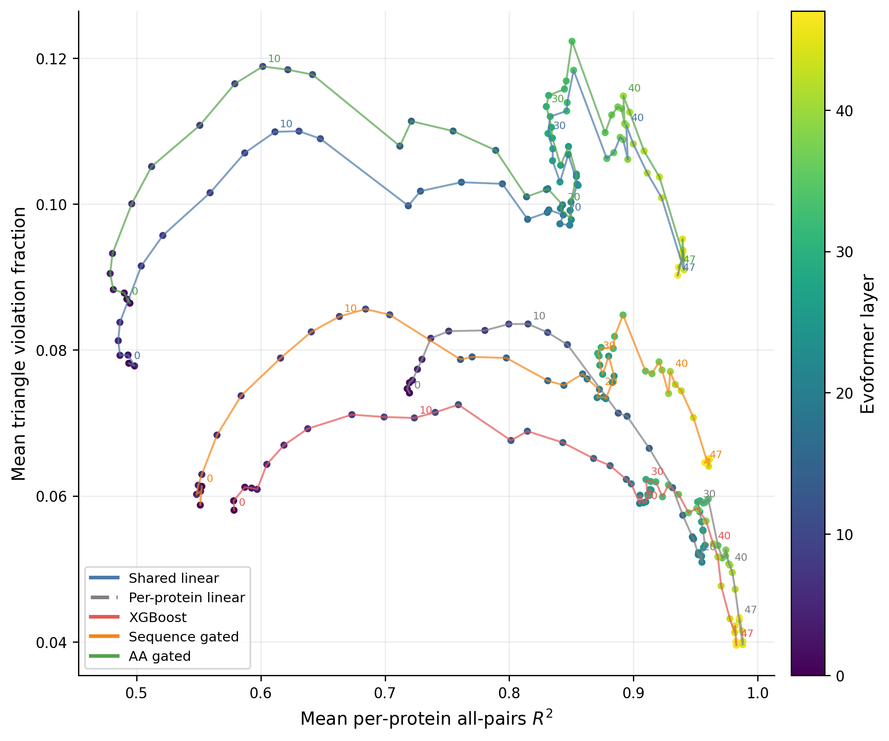

Each line traces one model through layer space, with all-pairs mean R2 on the
x-axis and triangle-violation fraction on the y-axis. A desirable movement is
rightward and downward.

The shared linear, sequence-gated, and AA-gated paths often move rightward
while also moving upward: distance accuracy improves before, and sometimes
without, improved metric consistency. XGBoost and per-protein linear move more
clearly toward the lower-right and finish with both high R2 and low violation
rates. The plot therefore separates two questions that R2 alone conflates:
whether individual distances are predictable and whether all predictions can
coexist as one geometry. The per-protein coordinates use the mixed all-pairs
scope required for a complete matrix.

Expanded phase plots for every exact-triangle metric and every true spatial-
distance MAE bin are collected in the
[decodability metric comparisons](paper_figures/decodability_metric_comparisons/README.md)
subdirectory. Those plots also mark individual transitions where R2 improves
while the plotted error worsens.

## Figure 9: MAE by sequence separation

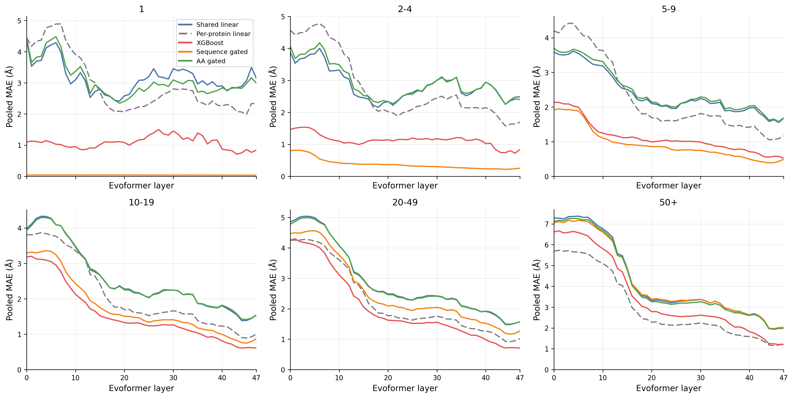

The six panels divide test pairs by absolute sequence separation. MAE is used
because adjacent residues have little target variance, making their R2
unstable.

Sequence gating almost solves separation-1 pairs from the start (about 0.04 Å
MAE) and is also strongest for separations 2--4. This mainly reflects the
highly predictable local backbone spacing made available by the gate, rather
than a layer-dependent structural discovery. Its advantage narrows by
separation 5--9 and reverses for long-range pairs, where XGBoost is strongest
among the shared models. For 50+ separation, XGBoost falls from 6.61 Å at layer
0 to 1.21 Å at layer 47. The large improvement in every model's long-range
bins is the clearest evidence that global relationships are progressively
refined through the trunk.

Figure 10 is absent because its leak-free sequence-bin baseline requires a
separate development/test replay and was not part of the generated catalog.

## Figure 11: All 210 amino-acid-pair R2 trajectories

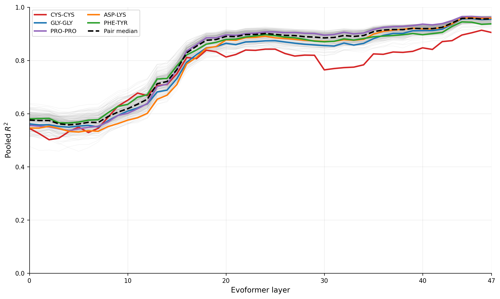

This uses the AA-gated model and shows every unordered standard amino-acid
pair. The five colored examples were chosen before plotting; the dashed curve
is the median over all pairs.

The dominant result is common refinement rather than 210 distinct programs.
Median pooled R2 rises from 0.576 at layer 0 to 0.956 at layer 47. The final
range is still meaningful, from 0.905 to 0.968, but most trajectories share the
same major rises and late peak. CYS-CYS is among the harder final categories.
Residue identity alone should not be interpreted as evidence for a disulfide
or any other specific interaction.

## Figure 12: All 210 amino-acid-pair MAE trajectories

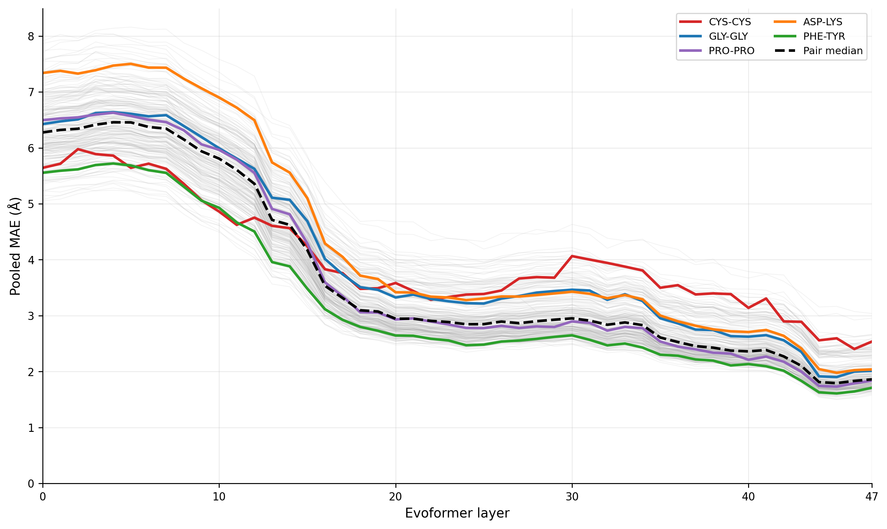

This is the absolute-error companion to Figure 11. Median pooled MAE falls from
6.28 Å to 1.86 Å, with a final range of 1.58--3.04 Å across pairs. The ordering
is not identical to R2 because amino-acid pairs have different distance
distributions and target variances. Pair-specific claims should therefore be
supported by both figures, not by R2 alone.

## Figure 13: Amino-acid-pair refinement timing

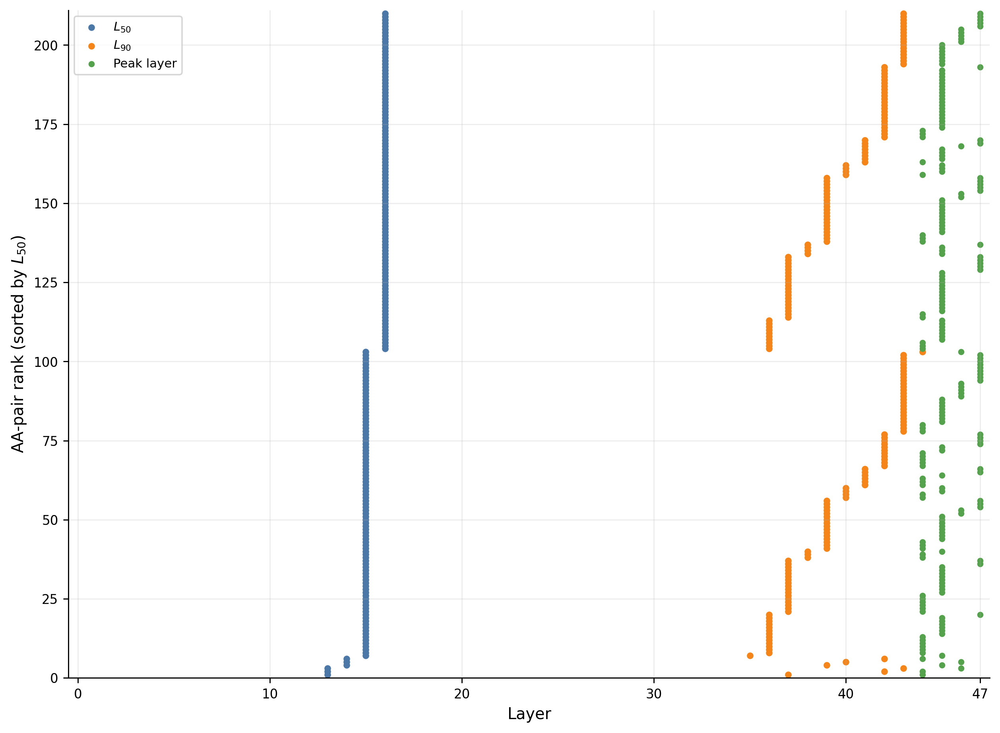

For each AA pair, `L50` and `L90` are the first layers reaching 50% and 90% of
the improvement from layer 0 to that pair's best R2; the peak layer is shown
separately. All 210 pairs had enough improvement for timing to be defined.

Refinement is strikingly synchronized. Every L50 lies between layers 13 and 16
(median 16), while L90 spans layers 35--44 (median 39) and the peak lies at
layers 44--47 (median 45). Most of the pair-to-pair difference is therefore in
late refinement, not initial onset. Final-layer reversals are small: the median
drop from peak R2 is 0.0016.

## Figure 14: Where AA gating helps

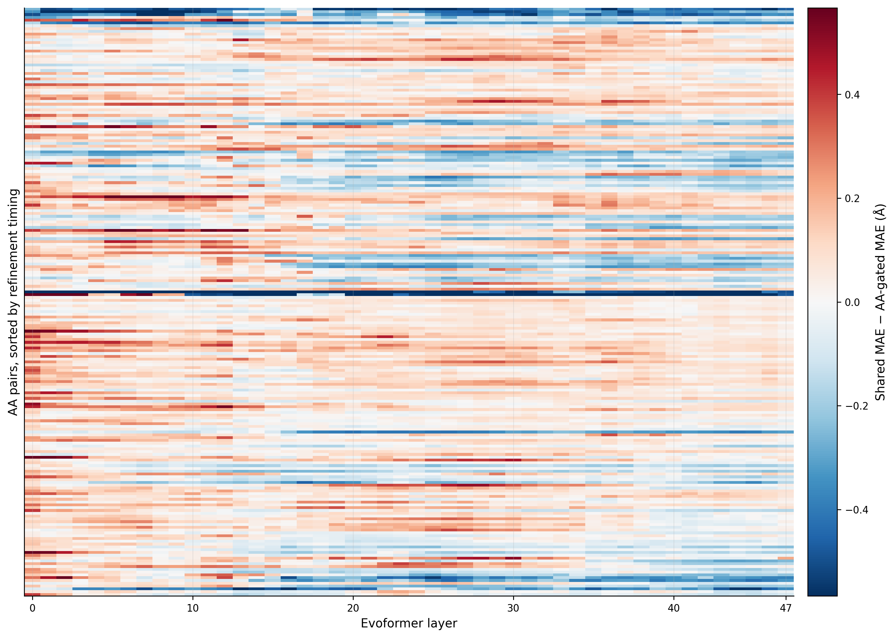

Each cell is shared-linear MAE minus AA-gated MAE for one pair and layer. Red
means the identity-specific decoder helps; blue means it hurts. Rows use the
timing order from Figure 13, and colors are clipped at the 99th percentile so
the bulk pattern remains visible.

The patchwork of red and blue explains why AA gating barely changes the global
curve: gains for some pairs are offset by losses for others, and the favored
pairs change with layer. The median gain is small at every inspected stage
(0.016 Å at layer 47). CYS-CYS is an unusually strong early positive outlier
but becomes one of the largest negative outliers in middle and late layers.
The result supports pair- and stage-specific decoder differences, not a general
advantage from splitting the model by amino-acid identity.

## Figure 15: MAE by true spatial distance

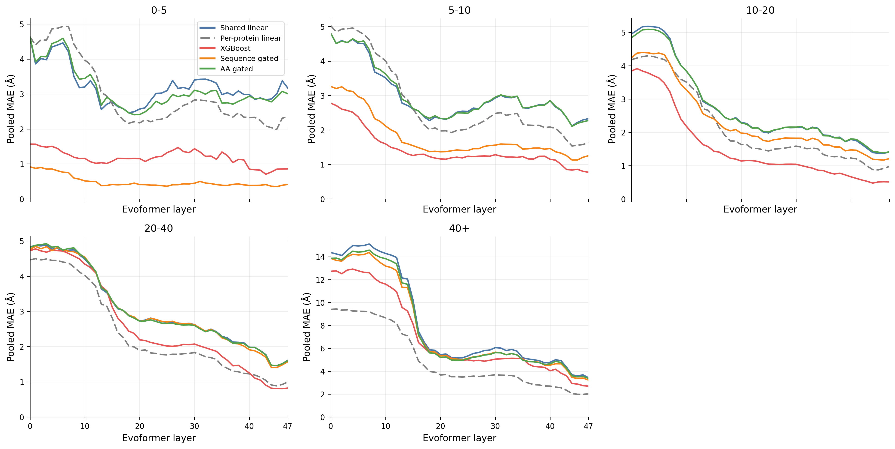

Pairs are grouped by their true final C-alpha distance only for evaluation;
true distance was not supplied to the probes or used for training.

Errors fall strongly in every distance bin, but 40+ Å pairs remain the hardest.
XGBoost is the best shared model across most medium- and long-distance bins and
ends at 2.69 Å for 40+ Å pairs. Sequence gating is exceptional for 0--5 Å pairs
(0.41 Å at layer 47), largely because this bin contains many locally adjacent
residues. Shared linear and AA gated again track one another closely. Very
short-range shared-linear error is nonmonotonic, reaching its best value near
layer 18 before worsening, so refinement is not simply local geometry first
and global geometry later.

## Figure 16: Broad ECOD categories

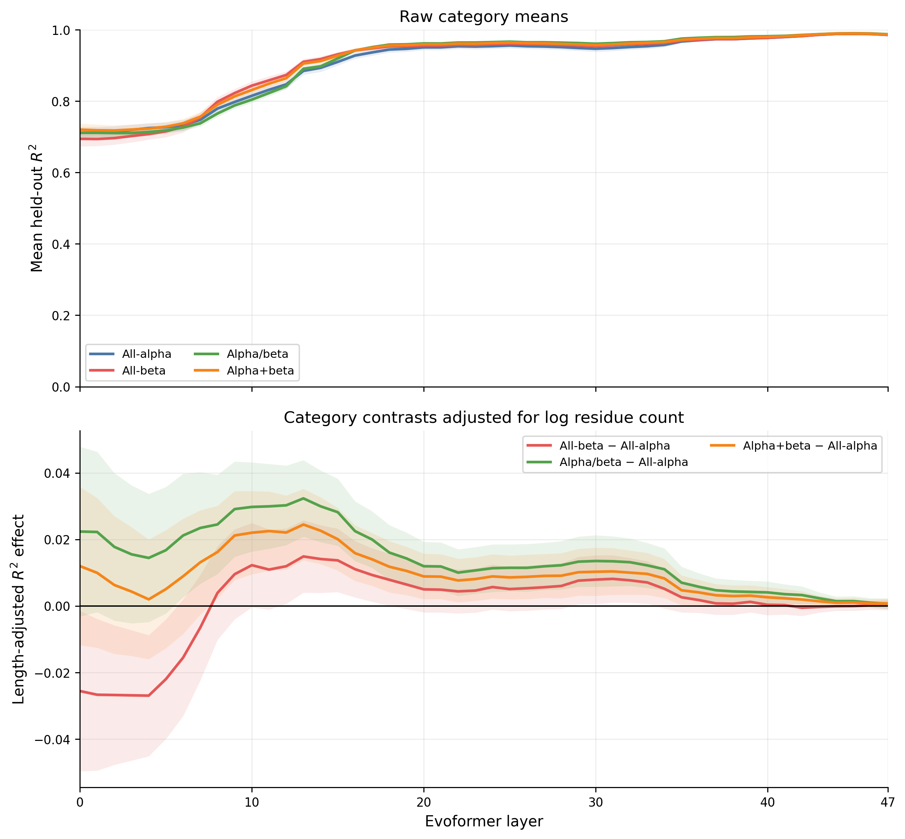

This switches to all 398 usable ECOD proteins and the per-protein model's
held-out-pair R2. The top panel gives raw means for four nearly balanced broad
structural categories. The bottom panel compares each category with all-alpha
after adjusting for log residue count; shaded bands are 95% intervals.

The broad groups share the same refinement schedule and converge near R2 0.986
at layer 47. The main differences are transient. Alpha/beta and alpha+beta
proteins are ahead of all-alpha proteins through much of the middle trunk,
with the largest adjusted alpha/beta advantage about 0.032 at layer 13. Many
of these small intermediate effects survive false-discovery correction, but
the contrasts shrink to roughly 0.001 by the final layer. Broad category thus
affects timing more than final accessibility.

## Figure 17: ECOD architectures

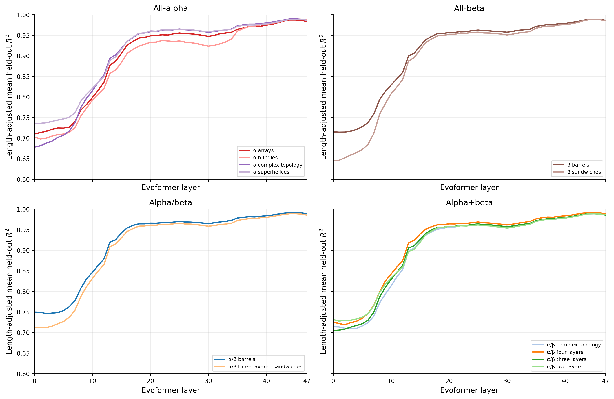

This repeats the ECOD analysis for 12 predeclared architectures, showing
length-adjusted mean held-out R2 within the four broad categories. The finer
labels reveal larger early differences: the cross-architecture spread is
about 0.10 R2 at layer 0, with beta sandwiches starting lowest and alpha/beta
barrels highest. The spread falls to about 0.03 by layer 23 and only 0.005 by
layer 47. Architecture again changes the starting point and refinement path
far more than the late endpoint.

## Figure 18: Protein length and refinement timing

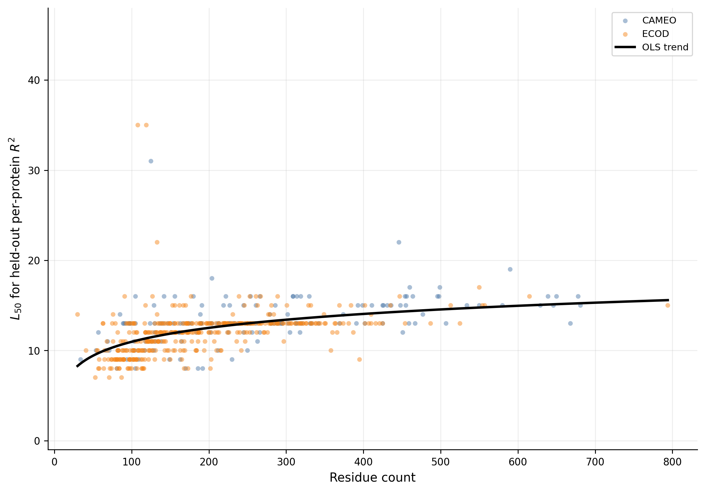

This uses all 552 usable proteins and the per-protein held-out-pair trajectory.
It plots residue count against R2 L50; source color is only a technical
diagnostic, not a biological CAMEO-versus-ECOD comparison.

Longer proteins reach half of their eventual R2 improvement later. In the
all-protein regression, doubling length corresponds to about 1.54 additional
layers to L50 (95% CI 1.30--1.79). The ECOD-only analysis adjusted for broad
category gives nearly the same result. Longer proteins also reach their best
score slightly later and show a larger total improvement. There is no clear
all-protein association between length and R2 L90, so length primarily shifts
the early-to-middle refinement schedule rather than uniformly delaying every
stage.

## Figure 19: TO BE DONE

This figure will be completed after the secondary structure prediction analysis completes.
The secondary structure prediction analysis will look at by what layers alpha helices
and beta sheets are accessible from the pair representation. The expected finding
of this analysis is that the sequence-gated linear probe will be the only probe that is
accurate at alpha helix prediction. This is because the MAE of all other models at
sequence se

## Overall interpretation

The pair representation contains substantial final-distance information even
at layer 0, but the trunk repeatedly reorganizes and sharpens that information.
By the late layers, a shared nonlinear decoder recovers nearly protein-specific
accuracy on unseen proteins and produces much more coherent geometry than a
shared linear decoder. The remaining gap between accurate distances and valid
geometry is scientifically important: distance decodability alone is not a
complete description of structural representation.

The subgroup results refine that story. Sequence scale is a strong and broadly
useful conditioning variable, especially for local backbone relationships.
Amino-acid identity matters selectively rather than globally. Structural class,
architecture, and length alter when information becomes accessible, but most
of those differences collapse near the final layers. The most defensible
conclusion is therefore a shared, staged refinement process with readout- and
context-dependent accessibility, not a single monotonic march toward the final
structure.
