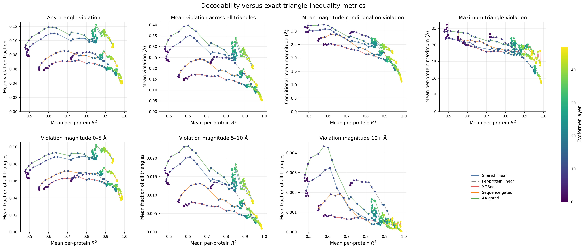
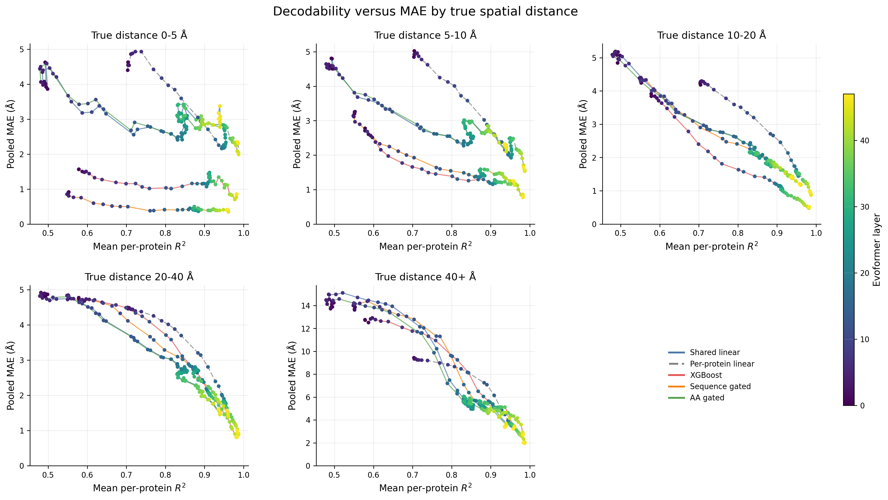

# Expanded decodability-versus-error comparisons

These figures extend main Figure 8 by tracing each probe through layer space
with mean per-protein R2 on the x-axis and a second error or consistency metric
on the y-axis. Movement toward the lower right means that distance decodability
and the plotted metric improve together. Point color gives the Evoformer layer.

## Overview figures



The triangle overview contains the six canonical exact-triangle outputs plus
the derived mean magnitude conditional on a violation. The included metrics
are total violation fraction, mean violation over all triangles, conditional
mean magnitude, per-protein maximum violation, and the fractions in the 0--5,
5--10, and 10+ Angstrom severity bins.



The spatial overview splits pooled MAE by the true-distance bins 0--5, 5--10,
10--20, 20--40, and 40+ Angstrom. True distance is used only to stratify the
evaluation pairs; it is not an input or training gate.

Each overview panel also has its own full-size PNG and PDF in this directory.
`figure_manifest.csv` lists all 14 figure pairs and their source digests.

## What the comparison shows

The broad motion is toward the lower right, especially after the middle
layers: later representations generally make distances more decodable while
reducing violation severity and spatial-bin MAE. The paths are not monotonic,
however. Across the five models and 47 incoming layer transitions (235
transitions per metric), the number of R2-up/MAE-up transitions is:

| True-distance bin | R2 up, MAE up |
|---|---:|
| 0--5 Angstrom | 74 / 235 |
| 5--10 Angstrom | 53 / 235 |
| 10--20 Angstrom | 25 / 235 |
| 20--40 Angstrom | 23 / 235 |
| 40+ Angstrom | 33 / 235 |

So the answer to whether overall R2 can improve while large-distance MAE gets
worse is yes, at particular transitions. It happens less often than for the
shortest-distance bins and is usually a local reversal inside a much larger
overall fall in long-range MAE. For example, the 40+ Angstrom panel contains
33 such transitions, while its complete trajectories still move from roughly
9--15 Angstrom MAE early to roughly 2--4 Angstrom late.

Triangle-frequency metrics show more loops than the severity metrics. The
R2-up/metric-up counts are 91 for total violation fraction, 84 for mean
violation over all triangles, 66 for conditional mean magnitude, 63 for the
maximum, and 101, 82, and 83 for the 0--5, 5--10, and 10+ Angstrom fractions.
Thus better marginal distance prediction does not guarantee that the decoded
matrix becomes more metric-consistent at every layer, even though violation
severity tends to improve strongly by the final layers.

## Evaluation conventions

- Triangle plots reproduce Figure 8's convention: both axes are
  protein-equal means over all test-protein pairs. The per-protein linear
  all-pairs R2 mixes its fitted and held-out pair subsets because complete
  distance matrices are required for triangle metrics.
- Spatial plots use each model's primary scope on both axes. Shared and gated
  models use all pairs on unseen test proteins; per-protein linear uses held-out
  pairs within the same test proteins.
- Spatial-bin MAE is pooled across pairs, whereas the x-axis R2 is averaged
  across proteins. The plot compares their layer trajectories; it does not
  imply that the two axes use identical weighting.

The exact plotted coordinates are in `comparison_points.csv`.
`layer_transition_directions.csv` adds the two signed layer changes and the
`r2_up_comparison_worse` indicator. Regenerate all outputs with:

```bash
.venv/bin/python scripts/multi_protein/generate_decodability_metric_comparisons.py
```
