# Similarity between the distance probes across layers

November 18, 2026. All 552 proteins of the frozen cohort, 48 layers, four probe
families. Nothing was refitted: every number comes from the frozen probes, their
stored out-of-fold predictions, and the final structure PDBs.

**Averaging.** Every figure shows a per-protein metric averaged over proteins
with equal weight. Weight cosines are taken within an outer fold and averaged
over the five folds. Nothing is pooled over residue pairs. `7stz_C` is included.

## Summary

- **Predictions are similar across the whole stack; errors are not.** For the
  shared linear probe, predicted distances at layers 0 and 47 still correlate at
  0.75 within a protein, but their errors correlate at only 0.10. Adjacent layers
  correlate at 0.99 for predictions and 0.91 for errors.
- **Error similarity falls off the same way for every probe.** By 10 layers apart
  it is 0.44–0.51 for all four families, and by 30 layers 0.17–0.25. The layers
  disagree about where they are wrong regardless of the probe used to read them.
- **Probe weights rotate steadily.** Shared linear weight cosine is 0.93 between
  adjacent layers, 0.61 at 10 layers apart and 0.17 between layers 0 and 47. Two
  folds at the same layer agree at 0.99, so this is not fitting noise.
- **Three measures agree on a block structure, with breaks near layers 8, 13–16
  and 35.** Weights, errors and transfer all show an early block, a broad middle
  block (about 16–34) and a late block.
- **The largest single change is between layers 12 and 13.** It is the lowest
  adjacent prediction correlation (0.961), the second-lowest weight cosine
  (0.785), and the largest gain in mean per-protein R² (+0.063).
- **Similarity predicts transfer.** Across layer pairs, prediction correlation
  tracks transfer R² at Spearman 0.92 and weight cosine at 0.86 (0.92 within
  layers 16–47).

## 1. Effectiveness by layer

Mean over 552 proteins of each protein's own metric, from the producer tables.

| Probe | Metric | L0 | L16 | L24 | L47 |
|---|---|---:|---:|---:|---:|
| Shared linear | R² | 0.496 | 0.791 | 0.849 | 0.934 |
| | Absolute error (Å) | 5.27 | 3.22 | 2.69 | 1.74 |
| | TM-score | 0.462 | 0.672 | 0.737 | 0.850 |
| Sequence-gated linear | R² | 0.548 | 0.825 | 0.876 | 0.954 |
| | Absolute error (Å) | 4.86 | 2.86 | 2.37 | 1.44 |
| | TM-score | 0.471 | 0.686 | 0.751 | 0.870 |
| Per-protein linear | R² | 0.703 | 0.929 | 0.954 | 0.984 |
| | Absolute error (Å) | 4.12 | 2.03 | 1.58 | 0.94 |
| | TM-score | 0.508 | 0.767 | 0.837 | 0.934 |
| Shared XGBoost | R² | 0.578 | 0.866 | 0.909 | 0.981 |
| | Absolute error (Å) | 4.63 | 2.37 | 1.89 | 0.84 |
| | TM-score | 0.500 | 0.733 | 0.802 | 0.930 |

All four probes share one shape: flat to layer 5, a steep rise from 7 to 18, a
plateau with a slight dip through layers 24–31, and a second rise from 34.

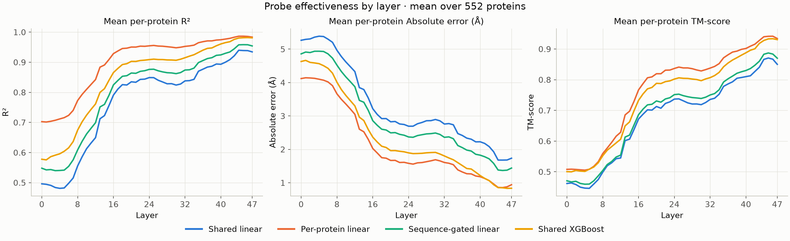

## 2. Weight similarity

Cosine between coefficient vectors (256 standardized coefficients, intercept
excluded), averaged over layer pairs at each distance apart.

| Probe | 1 apart | 5 | 10 | 20 | 30 | 40 | Same layer, across folds |
|---|---:|---:|---:|---:|---:|---:|---:|
| Shared linear | 0.928 | 0.741 | 0.611 | 0.452 | 0.291 | 0.196 | 0.990 |
| Gated, separation 1 | 0.812 | 0.469 | 0.289 | 0.142 | 0.091 | 0.042 | 0.987 |
| Gated, 2–4 | 0.960 | 0.865 | 0.801 | 0.706 | 0.591 | 0.422 | 0.999 |
| Gated, 5–9 | 0.963 | 0.859 | 0.784 | 0.704 | 0.588 | 0.380 | 0.998 |
| Gated, 10–19 | 0.945 | 0.787 | 0.661 | 0.529 | 0.354 | 0.284 | 0.997 |
| Gated, 20–49 | 0.934 | 0.753 | 0.618 | 0.462 | 0.302 | 0.222 | 0.994 |
| Gated, 50+ | 0.910 | 0.699 | 0.538 | 0.341 | 0.179 | 0.065 | 0.985 |

- The readout for short-range pairs (separation 2–9) is the most stable across
  depth, and the long-range readout (50+) changes the most. The separation-1
  gate is the exception: its weights decorrelate fastest, with a sharp break
  between layers 4 and 6.
- Raw-scale coefficients give the same picture with lower values (0.90 adjacent,
  about zero between layers 0 and 47).

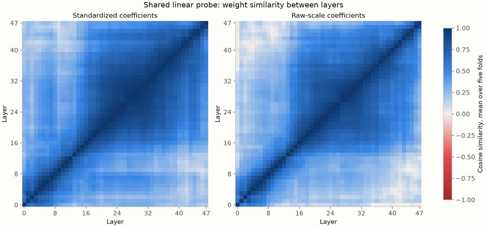

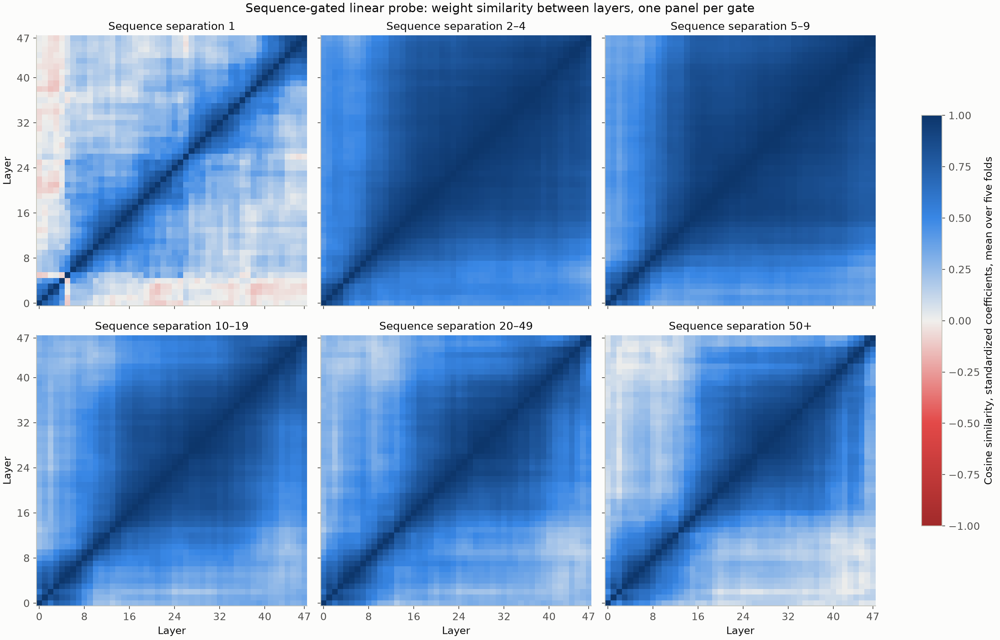

## 3. Prediction and error similarity

Pearson correlation within each protein, mean over proteins, averaged over layer
pairs at each distance apart. Spearman values are within about 0.03 of Pearson
for predictions and 0.02–0.07 lower for errors, with the same shape.

| Probe | Quantity | 1 apart | 5 | 10 | 20 | 30 | 40 |
|---|---|---:|---:|---:|---:|---:|---:|
| Shared linear | Predictions | 0.986 | 0.941 | 0.905 | 0.867 | 0.816 | 0.751 |
| | Errors | 0.912 | 0.668 | 0.498 | 0.337 | 0.199 | 0.099 |
| Sequence-gated linear | Predictions | 0.989 | 0.954 | 0.924 | 0.889 | 0.843 | 0.783 |
| | Errors | 0.913 | 0.678 | 0.512 | 0.348 | 0.208 | 0.101 |
| Per-protein linear | Predictions | 0.991 | 0.966 | 0.947 | 0.925 | 0.893 | 0.845 |
| | Errors | 0.902 | 0.656 | 0.492 | 0.346 | 0.251 | 0.167 |
| Shared XGBoost | Predictions | 0.986 | 0.960 | 0.934 | 0.904 | 0.864 | 0.807 |
| | Errors | 0.814 | 0.596 | 0.436 | 0.285 | 0.167 | 0.082 |

- Predictions stay correlated because every layer's probe recovers the same
  coarse distance pattern. The error correlation removes that shared part and
  shows how much of what a layer gets wrong is carried to other layers.
- XGBoost errors are less similar between adjacent layers (0.81) than the linear
  probes' (0.90–0.91), although its predictions are just as similar.
- Mean error correlation for the shared linear probe, by block of layers (block
  edges chosen from the earlier transfer segmentation):

| | 0–7 | 8–15 | 16–34 | 35–47 |
|---|---:|---:|---:|---:|
| **0–7** | 0.93 | 0.68 | 0.30 | 0.13 |
| **8–15** | | 0.80 | 0.41 | 0.18 |
| **16–34** | | | 0.74 | 0.40 |
| **35–47** | | | | 0.60 |

- Errors in layers 0–7 are nearly identical to each other (0.93), consistent
  with the flat effectiveness curve there. The late block is the least
  self-similar (0.60): errors change fastest from layer to layer between 41 and
  46, where adjacent error correlation drops to 0.78–0.83.

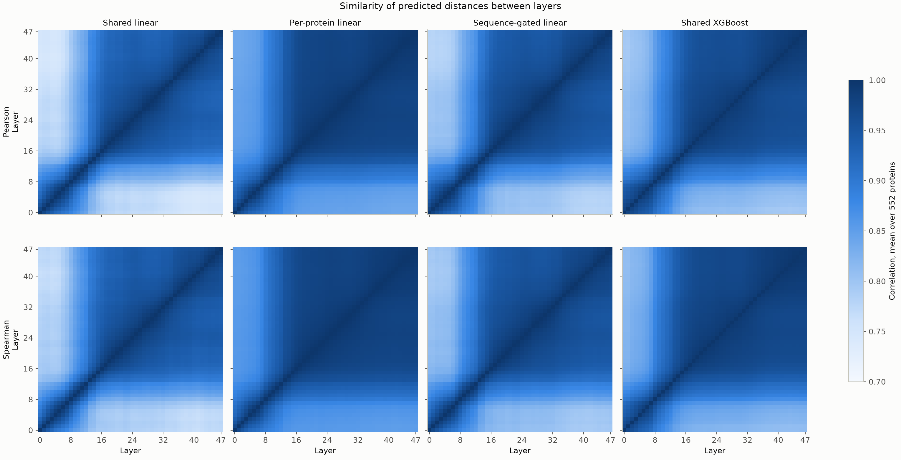

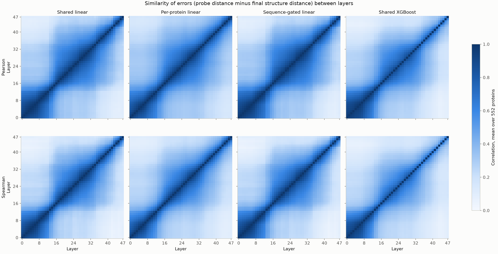

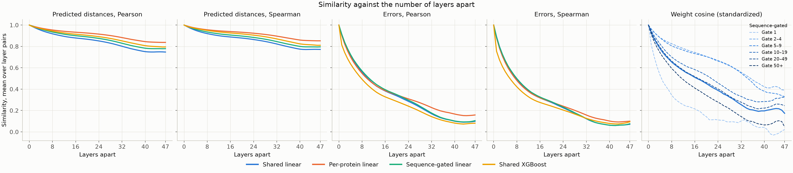

## 4. Transfer on all 552 proteins

The 48 × 48 transfer of the shared linear probe (`target_restandardized`) was
rerun on the full cohort; the earlier run covered the 154 CAMEO proteins only.
`analysis_status=complete`, 2,456 of 2,456 parity checks passed.

- Median per-protein R² within layers 16–47, by distance apart:

| Layers apart | Earlier probe on a later layer | Later probe on an earlier layer |
|---:|---:|---:|
| 1 | 0.870 | 0.869 |
| 5 | 0.813 | 0.779 |
| 10 | 0.774 | 0.684 |
| 20 | 0.683 | 0.534 |
| 30 | 0.359 | 0.252 |

- Probes carry forward better than backward, as on CAMEO.
- Probes from layers 0–7 fail on everything above about layer 10, and late
  probes fail on early layers: the mean per-protein R² is below zero in 565 of
  2,304 cells (the median in 454). The heatmap shows values below zero as zero.
- The heatmap uses the mean per-protein R², which a few badly predicted proteins
  pull down; the table above uses the median.

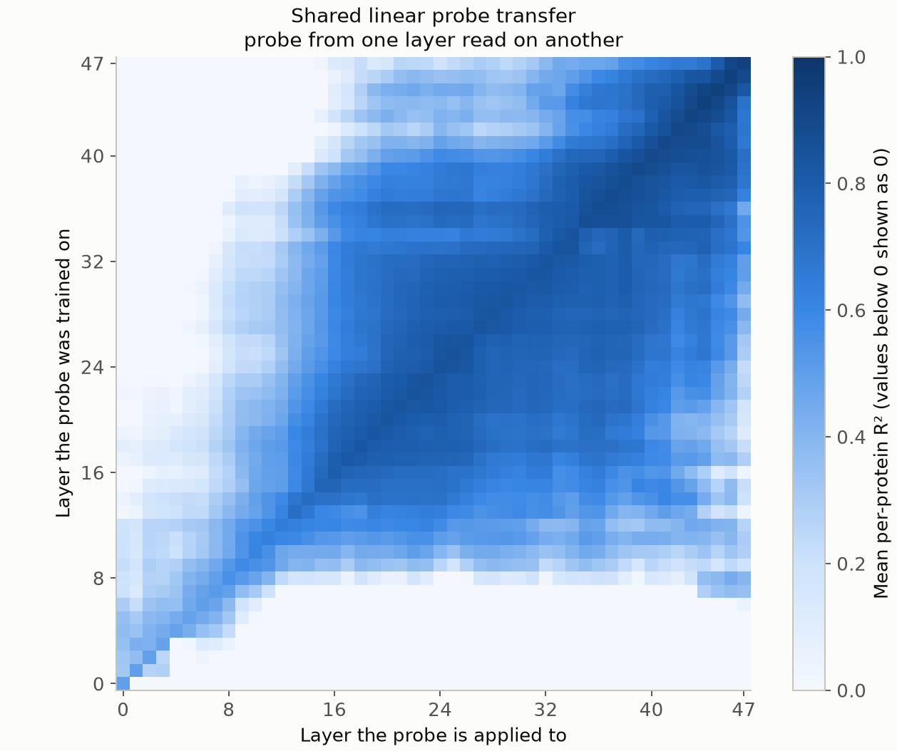

## 5. Transfer by sequence separation and by distance

The same transfer run, split by pair stratum: six sequence-separation bins and
five final-structure-distance bins, one axis at a time. Each protein's absolute
error is computed inside the stratum and then averaged over proteins. "Excess"
is the transferred probe's error minus the target layer's own probe's error on
the same protein and stratum. The 40+ Å bin has 479 proteins; the rest have 552.

Excess error as a fraction of the layer's own probe's error, within layers
16–47 (forward is an earlier probe on a later layer):

| Stratum | 5 apart, forward | 5, backward | 10, forward | 10, backward | 20, forward | 20, backward |
|---|---:|---:|---:|---:|---:|---:|
| All pairs | 0.33 | 0.37 | 0.50 | 0.60 | 0.94 | 0.93 |
| Separation 1 | 0.52 | 0.68 | 1.07 | 1.59 | 2.07 | 3.15 |
| Separation 2–4 | 0.41 | 0.48 | 0.81 | 0.95 | 1.30 | 1.73 |
| Separation 5–9 | 0.46 | 0.49 | 0.75 | 0.97 | 1.68 | 1.39 |
| Separation 10–19 | 0.42 | 0.49 | 0.62 | 0.85 | 1.25 | 1.27 |
| Separation 20–49 | 0.36 | 0.39 | 0.55 | 0.63 | 0.98 | 0.98 |
| Separation 50+ | 0.29 | 0.31 | 0.42 | 0.46 | 0.79 | 0.72 |
| Distance 0–5 Å | 0.48 | 0.64 | 1.01 | 1.44 | 1.83 | 2.73 |
| Distance 5–10 Å | 0.36 | 0.42 | 0.72 | 0.89 | 1.14 | 1.49 |
| Distance 10–20 Å | 0.41 | 0.43 | 0.67 | 0.71 | 1.30 | 1.19 |
| Distance 20–40 Å | 0.33 | 0.40 | 0.41 | 0.61 | 0.79 | 0.74 |
| Distance 40+ Å | 0.26 | 0.28 | 0.34 | 0.34 | 0.46 | 0.65 |

- **Transfer costs the most, relative to the layer's own probe, for pairs that
  are close in sequence or in space.** At 10 layers apart, forward transfer adds
  107% to the error at separation 1 and 101% at 0–5 Å, against 42% at separation
  50+ and 34% beyond 40 Å.
- **The forward advantage is a short-range effect.** At 20 layers apart,
  backward transfer adds 315% at separation 1 against 207% forward. For
  separations of 20 or more the two directions cost the same.
- **Early and late layers fail in different ways.** Mean absolute error in Å:

| Stratum | Probes from layers 0–7 on layers 16–47 | Probes from layers 16–47 on layers 0–7 | Layers 0–7, own probe |
|---|---:|---:|---:|
| Separation 1 | 10.0 | 23.2 | 3.7 |
| Separation 2–4 | 11.2 | 10.1 | 3.6 |
| Separation 5–9 | 10.1 | 5.8 | 3.5 |
| Separation 10–19 | 10.4 | 6.3 | 4.0 |
| Separation 20–49 | 10.1 | 7.1 | 4.7 |
| Separation 50+ | 10.4 | 8.2 | 6.2 |
| Distance 0–5 Å | 10.2 | 21.0 | 4.1 |
| Distance 5–10 Å | 12.8 | 9.0 | 4.6 |
| Distance 10–20 Å | 8.9 | 6.4 | 4.6 |
| Distance 20–40 Å | 11.0 | 6.1 | 4.4 |
| Distance 40+ Å | 10.6 | 19.5 | 14.1 |

- Early probes read on later layers are about 10 Å off in every stratum alike.
  Later probes read on early layers are far worse on neighbours and contacts
  (21–23 Å) and on the most distant pairs (19.5 Å), but only 6–8 Å off in between.
- The sequence-gated weights in section 2 were most stable for separations 2–9,
  yet the shared probe's transfer is relatively costliest at short range. The two
  are different probes, and the ratio here is against a small baseline error, so
  this is not a contradiction, but it is worth a closer look.
- In a few cells the transferred probe is slightly better than the layer's own
  (99 of 2,304 beyond 40 Å, at most 26 in any other stratum). The excess
  heatmaps show those as zero.

Each panel has its own colour scale, and the top 5% of cells saturate.

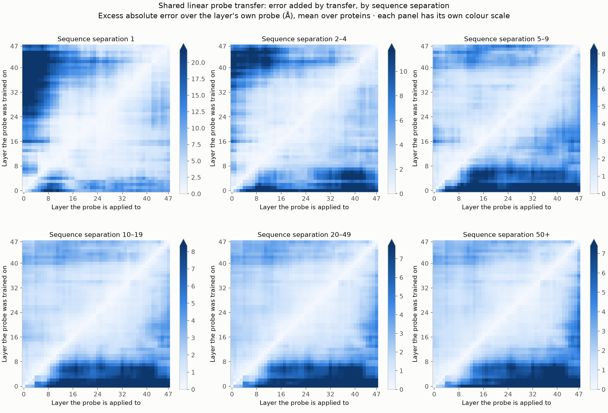

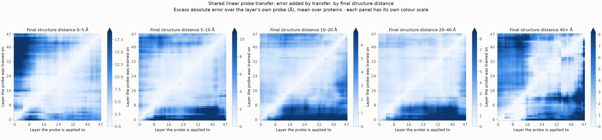

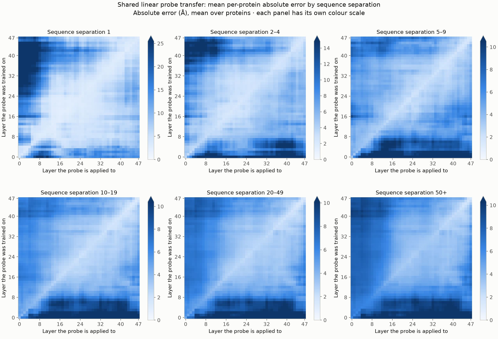

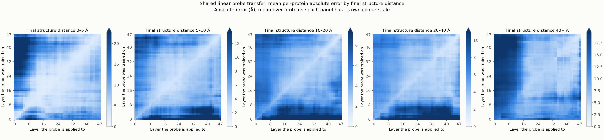

## 6. How the measures relate

- Across the 1,128 layer pairs, Spearman correlation with transfer R² (median
  per-protein, averaged over the two directions): prediction correlation 0.92,
  weight cosine 0.86, error correlation 0.67. Within layers 16–47 all three are
  0.90–0.93.
- Weight cosine and prediction correlation agree with each other at 0.91.
- Adjacent layers whose predictions differ more are the ones where effectiveness
  changes more (Spearman −0.62 between adjacent prediction correlation and the
  absolute change in mean R²). Adjacent weight cosine is a weaker guide (−0.42),
  and adjacent error correlation is not one (−0.14): late layers change their
  errors a lot while R² barely moves.
- Lowest adjacent weight cosines: 0→1 (0.71), 12→13 (0.79), 1→2 (0.84), 2→3
  (0.84), 45→46 (0.86). The first three layers reorganize the readout without
  improving it.

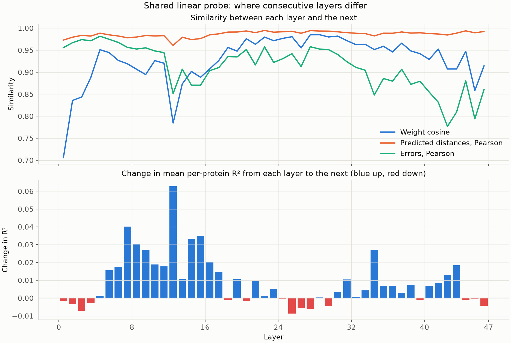

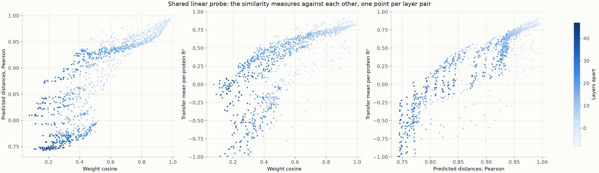

## Checks and limits

- Per-protein absolute error recomputed from the stored predictions matches the
  producer tables for all 4 probes × 48 layers × 552 proteins (largest difference
  1.2 × 10⁻⁷ Å). All coefficient and PDB checksums match. No similarity value is
  non-finite.
- Weight similarity for the per-protein linear probe was left out by decision.
- Weight cosine is measured in each layer's own channel coordinates. A low value
  means the readout direction differs, not that distance information is absent.
- Prediction and error similarity compare each layer's own probe on its own
  layer. Only the transfer matrix applies one layer's probe to another layer.
- The stratified whole-protein error reproduces `transfer_matrix.csv` to 2 × 10⁻¹⁵.
- The values at 40 or more layers apart rest on few layer pairs (eight at 40,
  one at 47).

## Sources

| What | Where |
|---|---|
| Similarity tables | `delta_files/diagnostic_experiments/probe_layer_similarity_v1/` |
| Transfer tables, 552 proteins | `delta_files/diagnostic_experiments/cross_layer_probe_transfer_all_layers_v1/` |
| Figures (PNG and PDF) | `delta_files/diagnostic_plots/probe_layer_similarity_v1/` |
| Code and runbook | `scripts/cluster_scripts/diagnostics/probe_layer_similarity/` |
| Full outputs on Delta | `~/diagnostic_experiments/probe_layer_similarity_v1/`, `~/diagnostic_experiments/cross_layer_probe_transfer_all_layers_v1/` |
| Jobs | transfer replay `24125962`, aggregation `24125963`, similarity `24125964`, figures `24125965` and `24128141`, transfer by stratum `24134288` |
