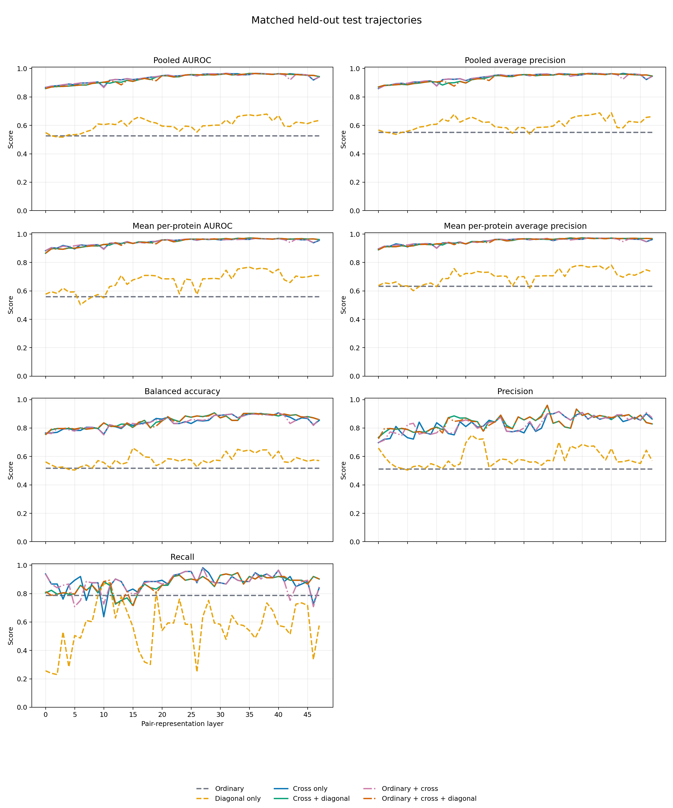
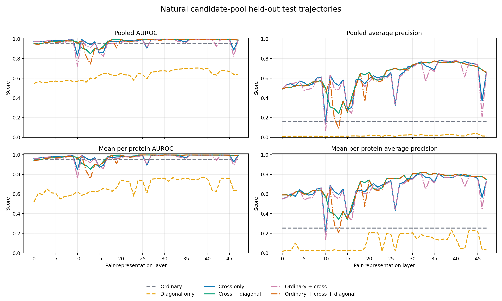
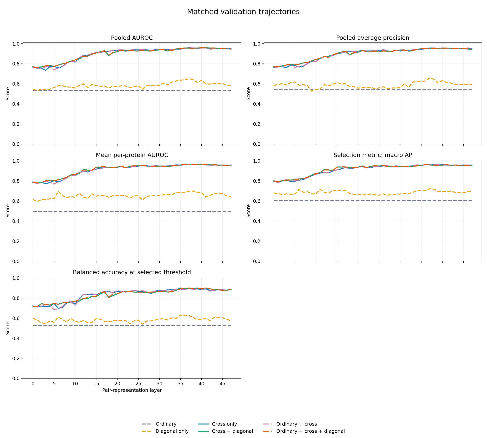
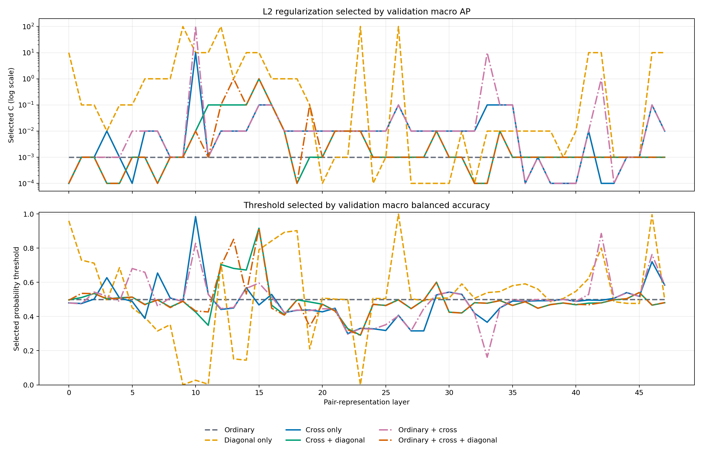
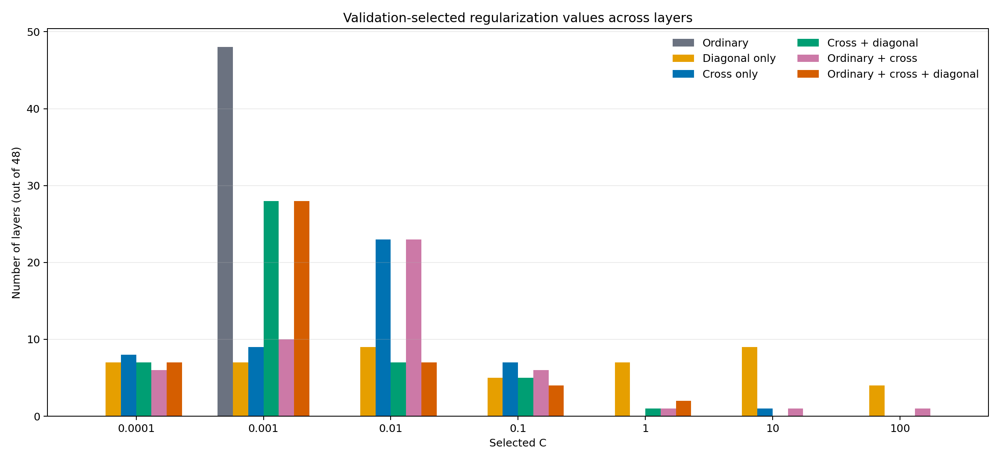
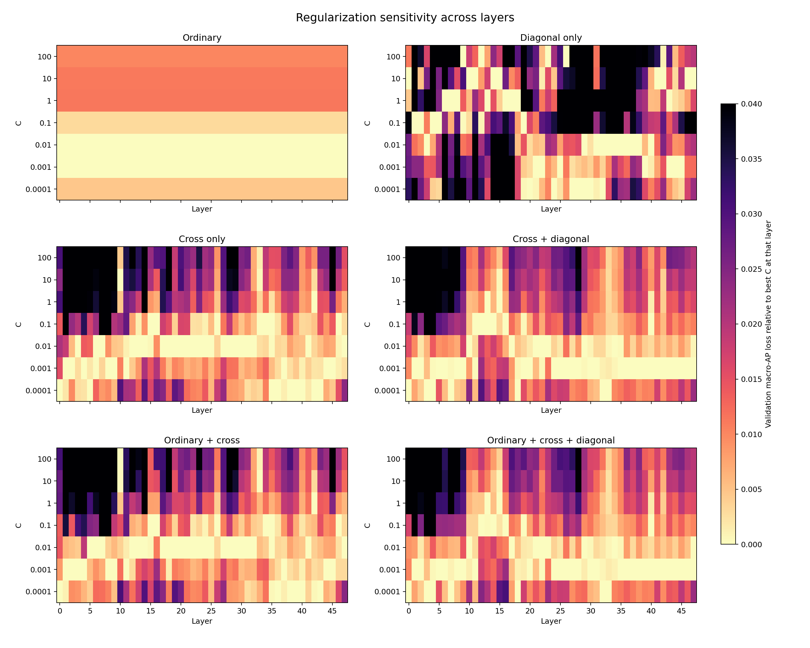

# Salt-bridge classification trajectories across OpenFold layers

## Executive summary

The 48 layer-level runs are complete, converged, and directly comparable: every
layer uses the same 30/10/10 protein split, matched pairs, model variants, and
evaluation scopes. Cross-residue features already classify salt bridges well at
layer 0 and improve through the trunk, reaching their strongest matched-test
performance around layers 29--42. The exact peak depends on the metric, and
there is a modest decline at layers 46--47.

Cross features are the important signal. Diagonal-only features remain much
weaker and fluctuate substantially, while adding ordinary or diagonal features
to cross features produces little consistent ranking improvement. Across all 48
layers, `ordinary_plus_cross` changes matched-test pooled AUROC by -0.0009 and
average precision by -0.0008 on average relative to `cross_only`. These are
negligible differences.

The seven-value regularization grid is larger than necessary for the
cross-family models. A four-value grid of `C = {0.0001, 0.001, 0.01, 0.1}`
recovers the exact seven-value optimum in 96.4% of layer/model cases. Its mean
validation macro-AP loss is 0.00010 and its worst observed loss is 0.00433.
This is the recommended grid for future cross-feature probes. Diagonal-only is
more hyperparameter-sensitive and should retain a wider grid if it remains a
scientific target.

## Data and evaluation design

- Source: 48 salt-bridge classification runs, layers 0--47.
- Split: 30 training, 10 validation, and 10 test proteins; identical at every
  layer.
- Training: one-to-one within-protein matched salt bridges and acidic--basic
  controls.
- Model selection: highest mean per-protein average precision on the matched
  validation set.
- Threshold selection: highest mean per-protein balanced accuracy on matched
  validation data.
- Held-out evaluation: matched test pairs and the natural acidic--basic
  candidate pool.
- Model variants: ordinary, diagonal only, cross only, cross + diagonal,
  ordinary + cross, and ordinary + cross + diagonal.

The matched test set is balanced (113 positives and 113 negatives), so its
pooled balanced accuracy equals ordinary accuracy. The natural test pool is
highly imbalanced (120 positives among 16,128 candidates), making average
precision more informative than accuracy.

## Matched held-out test trajectories

The cross-only trajectory rises from AUROC 0.867 and AP 0.859 at layer 0 to a
maximum AUROC of 0.965 at layer 31 and maximum AP of 0.966 at layer 42. Its
highest balanced accuracy is 0.907 at layer 40. At layer 47 it remains strong
(AUROC 0.941, AP 0.945, balanced accuracy 0.854), although it is below the
mid-to-late-layer peak.

The diagonal-only trajectory is qualitatively different. Its best pooled AUROC
is 0.679 at layer 38, best AP is 0.689 at layer 40, and best balanced accuracy is
0.659 at layer 15. It never approaches any cross-family model. This supports an
interpretation in which the directed cross-residue representation, rather than
the two residue diagonals, contains the decodable interaction signal.

Adding feature groups to cross-only does not yield a stable ranking advantage:

| Variant versus cross-only | Mean AUROC change | Layers with higher AUROC | Mean AP change | Layers with higher AP |
|---|---:|---:|---:|---:|
| Cross + diagonal | -0.0035 | 10/48 | -0.0039 | 11/48 |
| Ordinary + cross | -0.0009 | 26/48 | -0.0008 | 29/48 |
| Ordinary + cross + diagonal | -0.0041 | 10/48 | -0.0042 | 11/48 |

Thresholded balanced accuracy sometimes improves after adding diagonal
features, but the direction is not mirrored by threshold-free AUROC or AP.
That pattern is more consistent with changes in calibration/threshold selection
than with a reliably better ranking representation.

## Natural candidate-pool trajectories

Natural-pool AUROC stays high for most cross-family layers, while AP follows a
nonmonotonic path. Cross-only AP begins at 0.491, reaches a minimum of 0.143 at
layer 10, then rises to 0.782 at layer 36 before ending at 0.663. Pronounced dips
also occur around layers 14--15, 26, and 46.

These dips do not imply that the same layers lose all matched salt-bridge
information. The models are trained and selected on matched controls, whereas
the natural pool contains a much broader and severely imbalanced negative
distribution. The divergence therefore measures generalization from the
matched design to the natural candidate distribution. It should be treated as
a real distribution-shift result, not combined with matched accuracy into one
score.

Diagonal-only natural-pool AP remains near zero throughout (maximum 0.035),
despite occasionally moderate matched performance. This is further evidence
that its signal does not generalize to realistic candidate ranking.

## Validation trajectories

Validation trajectories broadly reproduce the matched-test rise of the
cross-family models. Because hyperparameters are selected by validation macro
AP, this plot is useful for model-selection diagnostics but should not be used
as an unbiased estimate of final performance.

## Hyperparameter behavior

The probe searched `C = {0.0001, 0.001, 0.01, 0.1, 1, 10, 100}`. Smaller `C`
means stronger L2 regularization. The selected values across 48 layers were:

| Variant | Most common selections |
|---|---|
| Ordinary | 0.001 at all 48 layers |
| Cross only | 0.01: 23; 0.001: 9; 0.0001: 8; 0.1: 7; 10: 1 |
| Cross + diagonal | 0.001: 28; 0.01: 7; 0.0001: 7; 0.1: 5; 1: 1 |
| Ordinary + cross | 0.01: 23; 0.001: 10; 0.0001: 6; 0.1: 6; 1/10/100: 1 each |
| Ordinary + cross + diagonal | 0.001: 28; 0.01: 7; 0.0001: 7; 0.1: 4; 1: 2 |
| Diagonal only | Broadly scattered; 0.01 and 10 were each selected 9 times |

The rare extreme selections do not establish that extreme `C` values are
generally useful. Several validation curves are nearly tied, so a tiny score
difference can change the selected grid point by multiple orders of magnitude.
The sensitivity heatmap shows the score cost directly rather than only the
winning value.

If one fixed `C` is chosen for every layer of a given variant, the values that
maximize mean validation macro AP across all layers are:

| Variant | Best fixed `C` | Mean AP loss versus per-layer tuning | Worst loss |
|---|---:|---:|---:|
| Cross only | 0.01 | 0.00336 | 0.02095 |
| Cross + diagonal | 0.001 | 0.00300 | 0.02255 |
| Ordinary + cross | 0.01 | 0.00291 | 0.01936 |
| Ordinary + cross + diagonal | 0.001 | 0.00277 | 0.02269 |
| Diagonal only | 0.01 | 0.01590 | 0.06116 |
| Ordinary | 0.001 | 0 | 0 |

Thus fixed regularization is defensible for broad trajectory screening of the
cross-family models, with an average cost of about 0.003 macro AP. It is less
defensible for diagonal-only.

### Reduced-grid comparison

The following regrets compare the best value available in each reduced grid
with the best of all seven values, using validation macro AP across all layers:

| Grid | Cross-family exact optimum | Mean loss | 95th-percentile loss | Worst loss |
|---|---:|---:|---:|---:|
| 7 values: 0.0001--100 | 100% | 0 | 0 | 0 |
| 5 values: 0.0001--1 | 98.4% | 0.00006 | 0 | 0.00433 |
| 4 values: 0.0001--0.1 | 96.4% | 0.00010 | 0 | 0.00433 |
| 3 values: 0.001--0.1 | 81.8% | 0.00057 | 0.00372 | 0.01399 |
| 2 values: 0.001, 0.01 | 70.3% | 0.00147 | 0.01071 | 0.01880 |

Recommendation:

1. For cross-family probes, use the four-value grid
   `{0.0001, 0.001, 0.01, 0.1}`. It cuts the number of fits by 43% with a
   negligible observed selection-score cost.
2. If maximum conservatism is desired, retain `1` as a fifth value. Values 10
   and 100 add essentially nothing for the cross-family models.
3. If diagonal-only remains important, retain the full grid or at least include
   1 and 10; its validation curves are substantially less stable.
4. Do not choose hyperparameters from an arbitrary single early/middle layer.
   Applying layer-0 selections to all cross-family layers loses 0.0111 macro AP
   on average; layer-15 selections lose 0.0158 on average. Layer 47 happens to
   select the globally common pattern (`0.01` for cross-only/ordinary + cross,
   `0.001` for the diagonal-combined variants), costing 0.0030 on average, but
   that is a retrospective observation rather than a general one-layer rule.
5. If even four fits per layer are too expensive, predeclare the fixed values
   `0.01` for cross-only and ordinary + cross, and `0.001` for the two
   cross-plus-diagonal variants. This is preferable to borrowing an arbitrary
   layer's winners.

The reduced-grid and fixed-`C` conclusions concern validation macro AP. The
stored search files do not contain test predictions for every non-selected
`C`, so they cannot establish the exact test-set cost of each reduced grid.

## Reproducible outputs

- `layer_metrics.csv`: one row per layer × model variant × split/evaluation
  scope; 1,440 rows and the original summary columns.
- `hyperparameter_search.csv`: one row per layer × model variant × `C`; 2,016
  rows with validation selection metrics, convergence, and timing.
- `hyperparameter_summary.csv`: one row per model variant × `C`, summarizing
  selection frequency, validation macro AP, and regret across layers.
- `reduced_grid_analysis.csv`: one row per proposed grid × variant group.
- `single_layer_C_transfer.csv`: one row per possible source layer, measuring
  the cost of transferring its selected cross-family `C` values to all layers.
- `analyze_salt_bridge_trajectories.py`: validates all inputs and regenerates
  every CSV and PNG in this directory.

## Limitations

- The same held-out test proteins appear in every layer, which makes layer
  trajectories paired and comparable, but choosing a single "best layer" from
  these test curves would itself tune on the test set. A confirmatory best-layer
  claim would require another held-out dataset or nested selection on validation.
- There are only 113 positive matched test examples, and per-protein ranking
  metrics are valid for eight of the ten test proteins. Small neighboring-layer
  differences should not be overinterpreted without paired uncertainty
  intervals.
- Labels describe salt bridges in OpenFold unrelaxed predicted structures, not
  experimentally observed interaction dynamics.
