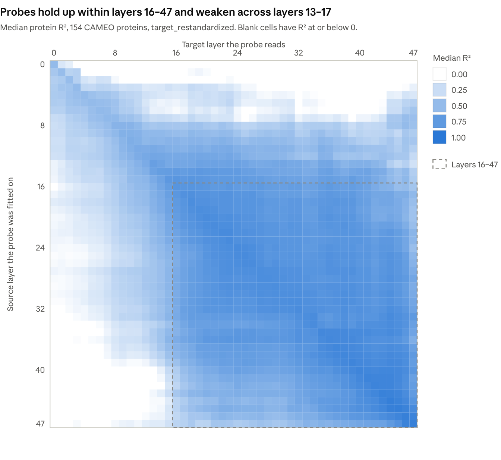
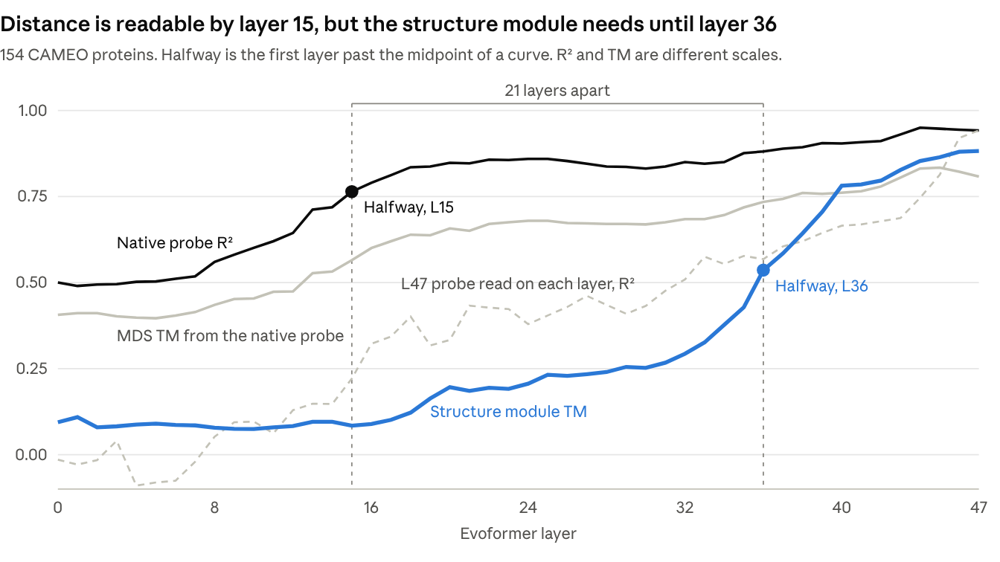
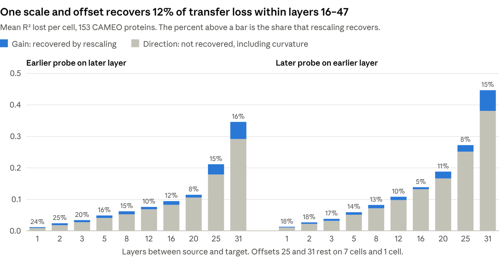
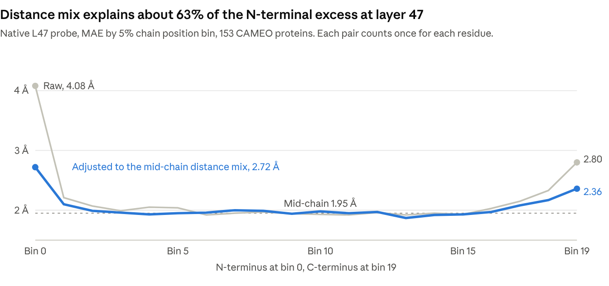
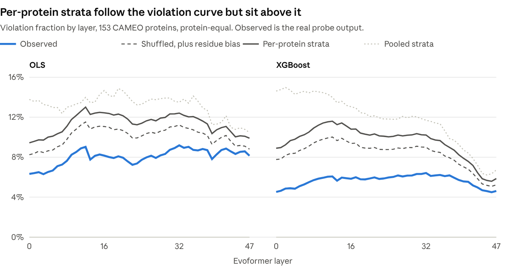
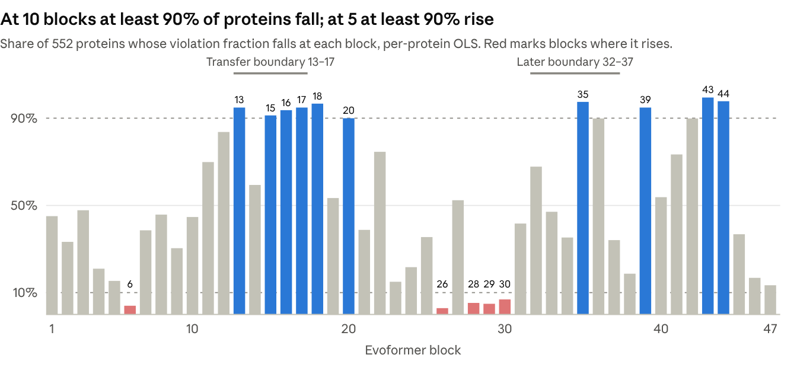
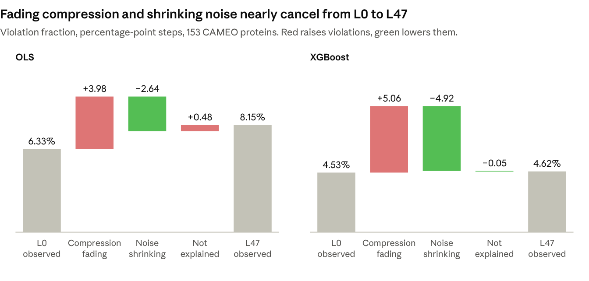

# All-Layer Probe Transfer and Triangle Violations Report

November 6, 2026

Linear probes read distance from the pair representation long before the structure module can use it. Transfer loss is mostly a change of direction, not of scale. Per-protein error strata explain the shape of the triangle violation curve but overstate its level, because errors correlate across a triangle's edges.

## Experiments run

Eight experiments ran on Delta, all on 2026-11-06, in the order below. Each one built on the replay in experiment 1 or on stored outputs.

| # | Experiment | Question | Data | Slurm jobs |
| --- | --- | --- | --- | --- |
| 1 | All-layer probe transfer | How well does each frozen probe read every other layer? | 240 OLS probes, 48 × 48 layers, 154 CAMEO proteins | `23615941`, `23616061`, `23616062`, `23616303`, `23617049` |
| 2 | Native error strata | Where does each layer's own probe go wrong? | OLS on 552 proteins and CAMEO; XGBoost on CAMEO | `23613749`, `23617393`, `23618658` |
| 3 | Mechanistic breakdown | What do the transfer tables imply about the representation? | Experiment 1 outputs and probe weights | `23618005` |
| 4 | Ablation and structure module | Do changes in the probes match what the network depends on? | 7 ablation sets, 552 proteins; structure module TM by layer | `23618578` |
| 5 | Gain versus direction | Is transfer loss a scale problem or a real loss of signal? | New replay of all 2,304 cells, CAMEO | `23618576`, `23618577`, `23618578` |
| 6 | Chain position × distance | Is the chain-end error real, or a long-distance mix effect? | Same replay as experiment 5 | `23618576`, `23618577`, `23618578` |
| 7 | Triangle violations against the strata | Do the error strata explain violations? | OLS and XGBoost, 153 CAMEO proteins | `23623120`, `23623121`, `23623122` |
| 8 | Violation events and two forces | Are the drops real, and why do violations ignore accuracy? | Stored geometry, 552 proteins, 4 probe families; experiment 7 | `23623617` |

Code is in [`cross_layer_transfer_all_layers`](../../../../scripts/cluster_scripts/diagnostics/cross_layer_transfer_all_layers/README.md) (experiment 1), [`native_error_strata`](../../../../scripts/cluster_scripts/diagnostics/native_error_strata/README.md) (experiment 2), and [`transfer_followups`](../../../../scripts/cluster_scripts/diagnostics/transfer_followups/README.md) (experiments 3 to 8). Result tables are in [`delta_files/diagnostic_experiments/`](../../../../delta_files/diagnostic_experiments/).

## Methodology

Every experiment reuses frozen probes or stored predictions; no probe was refitted. Results are out of fold, so a fold's probe only ever reads that fold's held-out proteins.

### Shared setup

- **Representation:** OpenFold pair representation, 48 Evoformer layers, 0 recycles. Layer L is the output of block L, so block b is the step from layer b−1 to layer b.
- **Probes:** frozen `shared_ols_base256` linear probes, 5 outer folds per layer, 240 in total. Each reads 256 directional features, `[Z_ij | Z_ji]`.
- **Target:** C-alpha distance in OpenFold's own final predicted structure, called final structure distance here. Signed error is probe minus final structure.
- **Cohort:** 154 CAMEO proteins, because the ECOD pair tensors and final structures became unavailable on 2026-11-06. Tables on all 552 proteins are used only where they were already stored.
- **Outlier:** `7stz_C` (590 residues) dominates pair-weighted error. It is excluded where stated, leaving 153 proteins.

Transfer uses `target_restandardized` only. A source probe keeps its coefficients and intercept, and takes the target layer's same-fold scaler:

```math
\hat{y}_{s \to t} = b_s + \left(\frac{x_t - \mu_t}{\sigma_t}\right) \cdot w_s
```

### Method by experiment

1. **All-layer probe transfer.** Each of the 240 probes was replayed on all 48 target layers, giving 2,304 cells over 7,403,166 pairs. Each cell stores per-protein statistics, signed error histograms, 13 sequence by 17 distance bins, and 20 chain position bins. The run passed 792 of 792 checks, including all 48 native cells against the producer.
2. **Native error strata.** Stored native predictions were binned by the same 13 sequence and 17 distance bins at every layer, with mean and SD of signed error. Claims were then tested protein by protein. Job `23613749` confirmed that these distances match the probes' training targets.
3. **Mechanistic breakdown.** Read-only analysis of experiment 1: optimal contiguous segmentation of the transfer matrix, retained R² by offset, weight cosine between layers and folds, calibration by distance, and paired protein comparisons.
4. **Ablation and structure module.** Seven component ablations were converted to the mean TM lost per block, then compared with probe series. Tests used Spearman correlation with 5,000 spectrum-preserving surrogates, 56 tests in all. Structure module TM by layer was also compared, by layer and across proteins, with length partialled out.
5. **Gain versus direction.** A new replay stored sum of prediction, its square, and its product with the target, per protein and distance bin. A single scale and offset was fitted on other folds with protein-equal weights, then applied out of fold, with native cells as the control.
6. **Chain position × distance.** The same replay crossed 20 chain position bins with distance and with sequence separation. End bins were directly standardized to the distance mix of mid-chain bins 5 to 14, then compared across all five folds.
7. **Triangle violations against the strata.** Six error models were added to final structure distances, and each was scored on the same triangles as the observed predictions. Proteins with more than 1,000,000 triples used a fixed sample of that size, and 50 proteins used every triple. Every layer had to reproduce the stored strata and violation fractions first.
8. **Violation events and two forces.** Stored geometry gave the share of proteins whose violation fraction falls at each block, for four probe families. Blocks where at least 90% fall were tested against earlier series with all 46 circular shifts. Violations were then regressed on the mean and SD of the margin, within protein and across layers.

Experiment 5 splits each cell's loss into two parts that sum exactly. Here R²′ is R² after the scale and offset are applied:

```math
\text{loss} = R^2_{t,t} - R^2_{s,t}, \quad \text{direction} = R'^2_{t,t} - R'^2_{s,t}, \quad \text{gain} = \text{loss} - \text{direction}
```

"Direction" means whatever one global scale and offset cannot recover, so it includes curvature as well as lost signal.

The margin in experiments 7 and 8 is the error on a triangle's longest edge minus the errors on its other two edges, with edges ranked by final structure distance. A triangle violates when one predicted side exceeds the sum of the other two.

## Results

### 1. All-layer probe transfer

Probes hold up inside layers 16–47 and weaken sharply across layers 13–17. By median protein R², no probe from another layer beat a layer's own probe in any of the 2,256 off-diagonal cells.



- **Reach:** within layers 16–47, a probe keeps about 98% of the target's native R² one layer away, 92–93% at five layers, and 69–81% at twenty.
- **Boundaries:** segmentation cuts the matrix at layers 13–17 in all five folds, on both axes. A later cut falls at layers 32–37 on the target axis in all five folds.
- **Why it decays:** probe weights rotate with depth. Cosine is 0.99 between folds at one layer, then 0.93, 0.74, 0.61, 0.45, 0.29 and 0.20 at offsets 1, 5, 10, 20, 30 and 40. Within layers 16–47, cosine tracks retained R² (Spearman 0.92).
- **Cost:** the L22 probe on L47 adds 4.29 Å of MAE over L47's own probe (IQR 3.91–4.65), and no protein improves. The L47 probe on L22 adds 3.00 Å.
- **Where the cost sits:** within layers 16–47 at offsets of five or more, 59% of excess squared error comes from pairs at least 50 residues and at least 40 Å apart.
- **Native steps:** the largest gains in median protein R² are at blocks 13 (+0.068), 15 (+0.045), 8 (+0.042) and 35 (+0.027).
- **Outlier:** `7stz_C` is the top squared-error contributor in all 2,304 cells. It also shapes the probes: at L22, the fold that never trained on it has a weight cosine of 0.976 to the others, against 0.997 among them.

### 2. Native error strata

At layer 47, both probes are close to right at 8–40 Å and both read long-range pairs short. XGBoost has the lower error: pooled MAE is 1.29 Å against 2.16 Å for OLS on the same 153 proteins. Each row below counts the proteins that satisfy a claim, on CAMEO.

| Claim at layer 47 | OLS: proteins holding | OLS: median | XGBoost: proteins holding | XGBoost: median |
| --- | --- | --- | --- | --- |
| Pairs beyond 100 Å read short | 13 of 13 | −39.2 Å | 13 of 13 | −26.3 Å |
| Pairs at 60–100 Å read short | 74 of 92 | −7.3 Å | 47 of 92 | −0.5 Å |
| Pairs at 8–40 Å are within ±1 Å | 142 of 154 | +0.18 Å | 152 of 154 | +0.04 Å |
| Pairs at 4–5 Å read long (separation 2 or more) | 137 of 140 | +1.55 Å | 140 of 140 | +0.67 Å |
| Pairs at 6–7 Å read short (separation 7 or more) | 129 of 149 | −1.04 Å | 17 of 149 | +0.19 Å |

- **The 6–7 Å short read is specific to OLS.** It holds in 129 of 149 proteins for OLS and only 17 of 149 for XGBoost, so it is not a property of the representation alone.
- **Depth helps every protein.** Whole-protein MAE is lower at L47 than at L0 in all 154 proteins, by a median of 4.24 Å for OLS and 4.58 Å for XGBoost.
- **Long-range flattening shrinks but stays.** Pairs beyond 100 Å read short by a median of 64.8 Å at L0, 50.7 Å at L22 and 39.2 Å at L47 with OLS. Only 13 proteins have such pairs.

### 3. Ablation and the structure module

The structure module's take-off sits about 21 layers after distance becomes linearly readable, and it lines up with the later transfer boundary. Block-by-block probe changes do not match ablation sensitivity.



- **Block by block, no match:** of 56 tests, 2 fell below p = 0.05, where 2.8 are expected by chance. The smallest p was 0.034.
- **Named blocks:** block 13 is the largest native R² step but adds only +0.006 structure module TM (rank 29 of 47). Block 35 adds +0.056 (rank 3). These are means over 552 proteins.
- **Take-off:** the seven largest structure module TM steps all land on layers 34–40.
- **Nearly fixed timing:** each protein's halfway layer falls at 34–38 (10th to 90th percentile) and is only weakly tied to length (Spearman 0.36).
- **Across proteins:** native R² predicts structure module TM from L38 onward (Spearman 0.46–0.61), and at most 0.28 before that. The L47 probe does not (−0.28 to 0.36).

Intact mean TM is about 0.92. The table reads FWD at L as ablating blocks 0 to L and REV at L as ablating blocks L to 47. These definitions are inferred from the data, because no document states them.

| Component ablated | FWD halfway layer | REV halfway layer | Largest loss in one block | Mean TM with all blocks ablated |
| --- | --- | --- | --- | --- |
| MSA transition | 1 | 25 | 0.677 at block 1, FWD | 0.07 |
| Triangle + TMU | 32 | 26 | 0.181 at block 32, FWD | 0.08 |
| MSA column attention | 1 | 2 | 0.591 at block 1, REV | 0.09 |
| Pair transition | 19 | 23 | 0.426 at block 19, FWD | 0.13 |
| TMU | 41 | 16 | 0.176 at block 41, FWD | 0.71 |
| Triangle attention | 37 | 16 | 0.035 at block 47, FWD | 0.75–0.76 |
| MSA row attention | 3 | 2 | 0.039 at block 3, FWD | 0.88 |

This comparison has limits. R² and TM are different scales, and TM is strongly nonlinear in distance accuracy. Structure module TM is not measured against the final structure, since L47 averages 0.92 rather than 1.0, so it cannot be compared directly with MDS TM. MDS TM is measured against the final structure and takes the better mirror image.

The structure module also reads the single representation, which these pair probes never see, and it was trained only on final-layer input. Ablation is cumulative, so a cliff at one block may reflect how many blocks remain, not that block's own role. Saved-layer outputs were confirmed for one protein only, and the script that made the TM table was not found.

### 4. Gain versus direction

Transfer loss is mostly not a scale problem. The L22 probe on L47 goes from R² 0.699 to 0.712 after rescaling, against 0.945 for L47's own probe. The L47 probe on L22 goes from 0.460 to 0.499, against 0.852.



- **Correction to an earlier reading:** the calibration slope of about −0.3 in transferred cells is not a fixable gain loss. The best rescaling slope is about 1.0. For L22 on L47, the slope of prediction on distance is 0.66 and r² is 0.72, which is how a well-calibrated predictor with less information behaves.
- **Control:** on native cells, rescaling adds 0.005 R² on average, with a median slope of 1.04.
- **Block 35 is the exception:** it is the only boundary where gain outweighs direction both ways (0.027 against 0.016 forward, 0.039 against 0.022 back). Native amplitude rises from 0.859 to 0.913, the L34 probe reads L35 at 1.07, and the L35 probe reads L34 at 0.73. Adjacent transfer cost ranks 2nd of 47, but weight rotation ranks 29th. Block 35 appears to change scale along the probe direction without turning it much.
- **Early probes overshoot:** layers 12 and below read on layers 16 and up have a slope of 0.62, and rescaling recovers 29% of the loss. L0 on L47 improves from −0.317 to 0.145, which is still far below 0.945.
- **Failure is asymmetric:** the L47 probe on L22 flattens at a mean prediction of about 36 Å, while L22's own probe reaches about 56 Å. The L22 probe on L47 still reaches about 56 Å. For L47 on L22, r² is 0.54 and the share of prediction variance tied to distance bins is 0.71, which points to curvature. For L22 on L47 those are 0.72 and 0.74, which points to scatter.

Amplitude is the SD of predictions divided by the SD of final structure distance. The curvature measure is approximate: it came out slightly negative on native L47, because binning discards some linear signal.

### 5. Chain position × distance

The chain-end effect is real but smaller than first reported. Chain ends simply hold more long pairs, and those explain about 63% of the N-terminal excess and 52% of the C-terminal excess at L47.



End-bin MAE as a multiple of the mid-chain rate, 153 proteins:

| Cell | N end, raw | N end, adjusted | C end, raw | C end, adjusted |
| --- | --- | --- | --- | --- |
| Native L0 | 1.73 | 1.22 | 1.36 | 1.17 |
| Native L16 | 2.02 | 1.31 | 1.55 | 1.24 |
| Native L22 | 2.04 | 1.42 | 1.57 | 1.30 |
| Native L33 | 2.14 | 1.38 | 1.55 | 1.25 |
| Native L47 | 2.09 | 1.40 | 1.44 | 1.21 |
| L22 probe on L47 | 1.41 | 1.09 | 1.13 | 1.02 |
| L47 probe on L22 | 1.97 | 1.16 | 1.37 | 1.07 |

- **Consistent across folds:** at L47 both ends stay above 1× in all five folds (N 1.29–1.54, C 1.08–1.31).
- **Sequence mix does little:** adjusting for sequence separation instead only moves the L47 N end from 2.09× to 1.99×.
- **Where it sits:** at L47 there is no excess under 8 Å. At 8–40 Å, the N end is about 1.5× mid-chain and the C end 1.2–1.3×.
- **Extent:** the N-terminal excess is nearly all in the first 5% of the chain. The C-terminal excess spreads over the last 15%.
- **The sign flips:** the raw N-end error at L47 is −1.05 Å, but +0.78 Å after adjustment, against about −0.2 Å mid-chain. So at a given distance, probes place chain ends too far apart. The raw under-prediction comes from long-range flattening.
- **Transfer ratios mislead:** they fall partly because mid-chain error grows. The excess is 0.78 Å for native L47 and 0.55 Å for the L22 probe on L47.

### 6. Triangle violations against the strata

The strata explain the shape of the violation curve only when kept per protein, and they overstate its level. The gap comes from errors that are correlated across a triangle's edges, which edge-at-a-time strata cannot capture.



The mean gap is model minus observed across 48 layers. Step correlation is how well a model follows layer-to-layer changes.

| Error model | OLS: mean gap | OLS: step correlation | XGBoost: mean gap | XGBoost: step correlation |
| --- | --- | --- | --- | --- |
| Random noise at the protein's accuracy | +0.167 | 0.39 | +0.146 | 0.31 |
| Pooled strata, means only | −0.063 | 0.43 | −0.051 | 0.41 |
| Pooled strata, mean and SD | +0.051 | 0.49 | +0.062 | 0.62 |
| Per-protein strata, mean and SD | +0.033 | 0.87 | +0.039 | 0.82 |
| Real residuals, shuffled within strata | +0.032 | 0.87 | +0.035 | 0.83 |
| Shuffled, plus each residue's own bias | +0.021 | 0.91 | +0.027 | 0.89 |

- **Pooled strata fail:** their level correlation with the observed OLS curve is −0.12, against 0.63 for per-protein strata.
- **Tails do not matter:** shuffling the real residuals adds nothing over a per-protein mean and SD.
- **Residue bias helps:** it closes about a third of the gap.
- **The gap shrinks with depth:** for OLS, observed is 68% of the per-protein model at L0–12 and 84% at L44–47. With residue bias those are 77% and 93%. XGBoost goes from 52% to 80%, and from 60% to 88%.
- **What is missing:** errors on a triangle's two longest edges correlate at about 0.21–0.28 in OLS. That makes the margin 11–17% narrower than with shuffled errors: 8.22 Å against 9.21 Å at L0, and 3.91 Å against 4.48 Å at L47.
- **Fit to the largest steps:** in OLS, block 39 is reproduced (−0.0090 observed, −0.0097 per-protein strata). Block 13 is only half reproduced (−0.0128 against −0.0072).
- **Which triangles fail:** in OLS at L47, 40% of triangles with relative slack under 0.02 violate, against 0.7% with slack of at least 0.3.
- **Two trends in opposite directions:** over 552 proteins with shared OLS, small triangles improve from L0 to L47 (0.148 to 0.106), while large obtuse triangles worsen (0.036 to 0.135).
- **Chain ends differ by probe:** at L47, OLS chain ends are under-represented among violating triangles (0.73× N, 0.86× C), while XGBoost's are over-represented (1.62×, 1.31×).

The pattern of errors is consistent with residues displaced in 3D, but that has not been tested.

### 7. Violation events and two forces

Violations fall in bursts, not smoothly, and they ignore accuracy because two forces cancel. From L0 to L47, R² rises from 0.50 to 0.94 while OLS violations only move from 6.3% to 8.2%.



`per_protein_ols` shares no weights between proteins, which makes this the cleanest signal. The 10 blocks are 13, 15, 16, 17, 18, 20, 35, 39, 43 and 44, against 46% at the median block. They form two bursts that roughly match the transfer boundaries.

- **Both cohorts:** the pattern holds in CAMEO and ECOD. Block 15 is the weakest case in CAMEO, at 78%.
- **Accuracy moves with it here:** at these 10 blocks, R² rises in at least 95% of proteins, against 86% at the median block. Across blocks, violation steps and R² steps correlate at −0.55 for these probes.
- **Other probes agree in part:** the share of proteins falling correlates at 0.57–0.69 with the other three families.
- **Block 35 depends on length in shared probes:** with shared OLS it is about −0.024 in short proteins, and between −0.006 and +0.006 in long ones. With `per_protein_ols` it is −0.005 to −0.008 at every length.
- **Length explains only part of the cohort gap:** block 35 is −0.0030 in CAMEO and −0.0162 in ECOD with shared OLS. Reweighting by length tertile closes only 32–44% of that gap, and ECOD falls further in every length group.
- **No sign that these drops help the structure module:** the block 35 step does not predict TM gain from L34 to L36 (Spearman 0.01). Over L34 to L40 it correlates at +0.32, and blocks 13 and 44 give +0.26 and +0.19 over their own steps. Positive means a smaller fall goes with a larger TM gain, the opposite of enabling. Violation fraction is also strongly tied to length, which may confound these.

The table tests whether earlier series run high at the 10 blocks, against all 46 circular shifts. A p of 0.021 is the smallest this test can give. With 8 tests, none passes correction.

| Series | Mean at the 10 blocks | Mean at other shifts | p |
| --- | --- | --- | --- |
| Native R² step | +0.0242 | +0.0090 | 0.021 |
| Native amplitude step | +0.0323 | +0.0066 | 0.021 |
| Pair transition ablation, REV | +0.0277 | +0.0165 | 0.043 |
| Adjacent transfer cost (Å) | +0.379 | +0.296 | 0.149 |
| Triangle + TMU ablation, REV | +0.0242 | +0.0177 | 0.191 |
| Structure module TM step | +0.0253 | +0.0175 | 0.213 |
| Pair transition ablation, FWD | +0.0347 | +0.0164 | 0.234 |
| Triangle + TMU ablation, FWD | +0.0034 | +0.0181 | 0.894 |

With shared OLS over 552 proteins, the violation step barely tracks the R² step (Spearman −0.19, p = 0.61). It tracks amplitude (−0.47, p = 0.014) and adjacent transfer cost (−0.39, p = 0.013) more closely, but neither passes correction for 6 tests.



The two forces are the mean and SD of the margin. In OLS the mean moves from −7.8 Å at L0 to −0.6 Å at L47, and the SD from 8.2 Å to 3.9 Å. A strongly negative mean gives triangles spare room, so early layers look clean because compression hides their error, not because their geometry is good.

The two terms account for 56% of the OLS layer curve and 85% of the XGBoost curve. Within proteins across layers they account for 50% and 60%.

## Findings

The representation runs on at least four separate timelines, and accuracy alone does not describe any of the others. Distance information, readout code, geometric self-consistency and structure module readiness all change at different depths.

### Well supported

- **Distance information arrives early.** Native R² passes its midpoint at L15, and by median protein R² no probe from another layer beats a layer's own probe.
- **Transfer loss is lost direction, not scale.** Rescaling recovers 12% of it within layers 16–47, and probe weights rotate steadily with depth.
- **Violation fraction is not a progress measure.** Compression fading and noise shrinking nearly cancel, so violations stay flat while R² nearly doubles.
- **Self-consistency improves in bursts.** At 10 blocks in two clusters, at least 90% of 552 proteins fall, using probes that share no weights.
- **Pooled strata do not explain violations; per-protein strata explain their shape.** They overstate the level because errors correlate across a triangle's edges. The gap narrows with depth.
- **Chain-end error is real but modest.** It is about 1.4× at the N end and 1.2× at the C end at L47, in all five folds.

### Tentative

- **Layers 22–34 may not be idle.** R² is flat and the code drifts while violations climb, then a burst arrives as the structure module takes off. Nothing here shows that this timing is causal.
- **Block 35 may rescale without rotating.** Gain outweighs direction both ways, but this rests on one boundary.
- **Long-range code may build forward.** L22's long-range readout survives at L47, while L47's is absent at L22.
- **Coherent error may be displaced residues.** The correlated edges fit that picture, but it has not been tested.

### Not supported

- **Violation drops enabling the structure module.** The event blocks do not line up with structure module steps, and protein-level correlations are near zero or run the opposite way.
- **Triangle operations driving the drops.** Triangle + TMU ablation does not match the event blocks in either direction.
- **Probe step sizes predicting ablation sensitivity.** 56 tests gave no more hits than chance.

### Corrections to earlier statements

- Chain-end error was first reported as about 2.1× and 1.4×. Those are raw figures, and the adjusted figures are 1.4× and 1.2×.
- The calibration slope of about −0.3 in transferred cells was treated as possible gain loss. It is mostly lost information, and the best rescaling slope is about 1.0.
- Blocks 13, 35 and 44 being the three steepest drops holds for shared and sequence-gated OLS over 552 proteins, but not for per-protein OLS or XGBoost. In CAMEO with shared OLS, the largest are 13 and 39.
- Block 35 was called a top drop in three of four families. XGBoost's drop there is only −0.0013, and its size depends on protein length in shared probes.

### Limits

- Experiments 1, 3, 5, 6 and 7 cover CAMEO only, and pooled CAMEO tables are not comparable with 552-protein tables. Everything should be re-run when ECOD returns.
- FWD and REV definitions, and the meaning of the structure module TM table, are inferred, not documented.
- The 90% event cutoff is a choice. At 85%, blocks 36 and 42 join the list. Per-protein probes may also look more consistent simply because they are less noisy.
- In experiment 7, the worst sampled check was z = 4.71 across about 10,000 comparisons. That is a little high, but well inside the limit of 6.
- Excluding `7stz_C` removes it from evaluation, not from the training folds that used it.

### Next steps

1. Compute distance R² and TM for the saved-layer structures against the final structure, which puts the structure module on the same scale as the probes.
2. Move residues in the final structure to match each protein's strata, then test whether that closes the remaining violation gap.
3. Re-run the replay and the strata on the full cohort when the ECOD inputs return.

## Reproducing this report

Experiments 3 to 8 first ran as scratch scripts, then moved to [`transfer_followups`](../../../../scripts/cluster_scripts/diagnostics/transfer_followups/README.md). Job `23624510` then ran the moved code from a flat deployment. Layer 47 of both replays matched the stored shards array for array, and all five analysis reports matched their first outputs line for line. The gain table and chart data matched byte for byte. The other 47 layers of each replay were not re-run.

Tables and text reports are in [`delta_files/diagnostic_experiments/transfer_followups_cameo_v1/`](../../../../delta_files/diagnostic_experiments/transfer_followups_cameo_v1/). Figures were drawn from `report_chart_data.json` in that folder, plus the values in the text reports. The `.npz` shards stay on Delta in `~/diagnostic_experiments/`, under `gain_and_chain_position_cameo_v1` and `triangle_strata_cameo_v1`.
